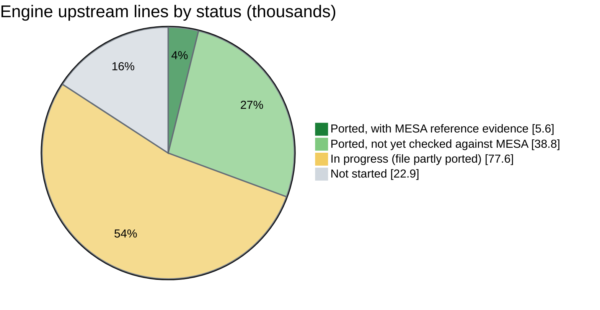
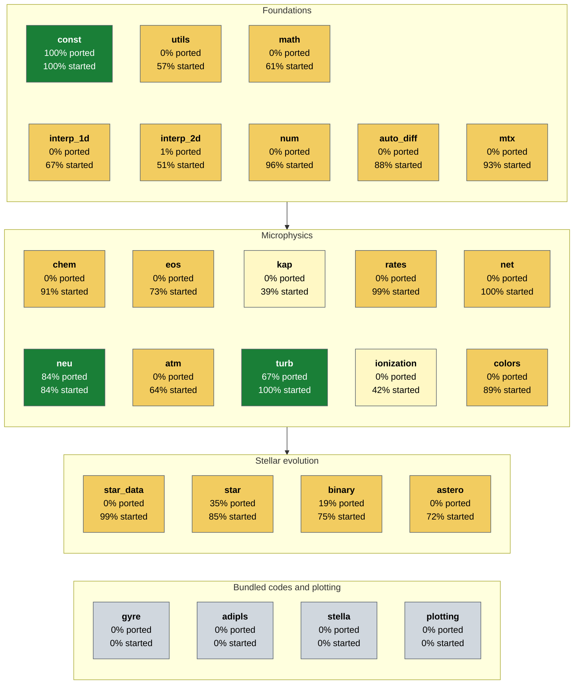

# FlexMESA

[](https://github.com/joshspeagle/FlexMESA/actions/workflows/ci.yml)
[](https://joshspeagle.github.io/FlexMESA/)
[](LICENSE)
[](https://github.com/MESAHub/mesa/releases/tag/26.4.1)
[](rust-toolchain.toml)
[](pyproject.toml)

**FlexMESA** ports [MESA (Modules for Experiments in Stellar Astrophysics)](https://github.com/MESAHub/mesa) into a canonical **Safe Rust** engine (`crates/`, enforcing `#![forbid(unsafe_code)]` across all crates except the sole vendored `crlibm` FFI wrapper `flexmesa-crlibm-sys`, exposed to Python via `PyO3` as `flexmesa._rust`) with a Python front end and a derived `float64` **JAX (`@jax.jit` + `jax.vmap`)** layer (`src/flexmesa/`). The long-term goal for `v0.1.0` (tracked against the live baseline counters in the dashboard below) is a faithful, evidence-verified port of **MESA release `26.4.1`** (git tag `26.4.1`, Zenodo record `19722306`), including the bundled codes required by its test suites (`notes/SCOPE.md`).

## Architecture & Scope Principles

1. **Canonical Safe Rust Engine (`strict` and `fast` Modes)**: Physics and evolution algorithms live in Safe Rust (`crates/`), with a default hardware-independent `strict` numerics mode (`crlibm 1.0beta4` matching `CRMATH`, no FMA) judged directly against MESA `26.4.1` and a `fast` mode validated against `strict` (`#165`, `DECISIONS #23`).
2. **Python Front End and Derived `float64` JAX Layer**: Python drives configuration, diagnostics, and plotting (`flexmesa.plotting`), while JAX (`src/flexmesa/`) provides forward and reverse automatic differentiation (`jax.grad`, `jax.jacfwd`, `@jax.custom_vjp`) and batched execution (`jax.vmap`) validated against Rust `strict` mode (`#166`).
3. **Evidence-Gated Parity Verification**: Every status table, end-to-end trajectory comparison (`notes/audit/case_table.md`), and dashboard counter below is generated mechanically from the repository, `benchmarks/dashboard/port_manifest.toml`, `benchmarks/history_harness/`, coverage reports, and the GitHub API (`#143`, `#145`, `#174`).

## Development Progress Dashboard

<!-- BEGIN GENERATED DASHBOARD -->
Generated by `flexmesa dashboard render`; do not edit by hand. Full tables: [progress dashboard](https://github.com/joshspeagle/FlexMESA/blob/main/docs/benchmarks/progress-dashboard.md) and [per-case table](https://github.com/joshspeagle/FlexMESA/blob/main/notes/audit/case_table.md).

[](https://github.com/joshspeagle/FlexMESA/blob/main/docs/benchmarks/progress-dashboard.md) [](https://github.com/joshspeagle/FlexMESA/blob/main/notes/audit/case_table.md) [](https://github.com/joshspeagle/FlexMESA/blob/main/notes/audit/case_table.md) [](https://github.com/joshspeagle/FlexMESA/blob/main/docs/benchmarks/progress-dashboard.md) [](https://github.com/joshspeagle/FlexMESA/blob/main/docs/benchmarks/progress-dashboard.md) [](https://github.com/joshspeagle/FlexMESA/issues/140)

**30.7% of the stellar-evolution engine is ported** (44.5k of 145k upstream MESA `26.4.1` lines in `star`, `star_data`, `binary` and `astero`). Upstream test-suite cases passing: **5 / 106**; 61 reach upstream's stopping condition and 14 are within tolerance of the MESA history.



### Modules



Colour: green = at least half ported; yellow = at least half started; pale = started; grey = not started. An arrow runs from a group to the group built on it. Percentages are shares of upstream lines from the port manifest.

| Module | Progress | Ported | Started | Upstream lines |
| :--- | :--- | ---: | ---: | ---: |
| **Foundations** | `▒▒▒▒▒▒▒▒▒▒▒▒▒▒▒▒░░░░` | 1% | 79% | 63,559 |
| `const` | `████████████████████` | 100% | 100% | 256 |
| `utils` | `▒▒▒▒▒▒▒▒▒▒▒░░░░░░░░░` | 0% | 57% | 3,633 |
| `math` | `▒▒▒▒▒▒▒▒▒▒▒▒░░░░░░░░` | 0% | 61% | 936 |
| `auto_diff` | `▒▒▒▒▒▒▒▒▒▒▒▒▒▒▒▒▒▒░░` | 0% | 88% | 14,353 |
| `mtx` | `▒▒▒▒▒▒▒▒▒▒▒▒▒▒▒▒▒▒▒░` | 0% | 93% | 5,802 |
| `interp_1d` | `▒▒▒▒▒▒▒▒▒▒▒▒▒░░░░░░░` | 0% | 67% | 4,969 |
| `interp_2d` | `▒▒▒▒▒▒▒▒▒▒░░░░░░░░░░` | 1% | 51% | 13,565 |
| `num` | `▒▒▒▒▒▒▒▒▒▒▒▒▒▒▒▒▒▒▒░` | 0% | 96% | 20,045 |
| **Microphysics** | `█▒▒▒▒▒▒▒▒▒▒▒▒▒▒░░░░░` | 3% | 74% | 104,712 |
| `chem` | `▒▒▒▒▒▒▒▒▒▒▒▒▒▒▒▒▒▒░░` | 0% | 91% | 4,195 |
| `eos` | `▒▒▒▒▒▒▒▒▒▒▒▒▒▒▒░░░░░` | 0% | 73% | 28,666 |
| `kap` | `▒▒▒▒▒▒▒▒░░░░░░░░░░░░` | 0% | 39% | 22,430 |
| `rates` | `▒▒▒▒▒▒▒▒▒▒▒▒▒▒▒▒▒▒▒▒` | 0% | 99% | 17,217 |
| `net` | `▒▒▒▒▒▒▒▒▒▒▒▒▒▒▒▒▒▒▒▒` | 0% | 100% | 13,452 |
| `neu` | `█████████████████░░░` | 84% | 84% | 2,184 |
| `atm` | `▒▒▒▒▒▒▒▒▒▒▒▒▒░░░░░░░` | 0% | 64% | 6,853 |
| `turb` | `█████████████▒▒▒▒▒▒▒` | 67% | 100% | 2,033 |
| `ionization` | `▒▒▒▒▒▒▒▒░░░░░░░░░░░░` | 0% | 42% | 3,859 |
| `colors` | `▒▒▒▒▒▒▒▒▒▒▒▒▒▒▒▒▒▒░░` | 0% | 89% | 3,823 |
| **Stellar evolution** | `██████▒▒▒▒▒▒▒▒▒▒▒░░░` | 31% | 84% | 144,952 |
| `star_data` | `▒▒▒▒▒▒▒▒▒▒▒▒▒▒▒▒▒▒▒▒` | 0% | 99% | 4,870 |
| `star` | `███████▒▒▒▒▒▒▒▒▒▒░░░` | 35% | 85% | 120,509 |
| `binary` | `████▒▒▒▒▒▒▒▒▒▒▒░░░░░` | 19% | 75% | 11,638 |
| `astero` | `▒▒▒▒▒▒▒▒▒▒▒▒▒▒░░░░░░` | 0% | 72% | 7,935 |
| **Bundled codes and plotting** | `░░░░░░░░░░░░░░░░░░░░` | 0% | 0% | 184,480 |
| `gyre` | `░░░░░░░░░░░░░░░░░░░░` | 0% | 0% | 55,708 |
| `adipls` | `░░░░░░░░░░░░░░░░░░░░` | 0% | 0% | 30,923 |
| `stella` | `░░░░░░░░░░░░░░░░░░░░` | 0% | 0% | 62,117 |
| `plotting` | `░░░░░░░░░░░░░░░░░░░░` | 0% | 0% | 35,732 |

Bar: `█` ported, `▒` started (file partly ported), `░` not started.

### Upstream test-suite cases

| Suite | Cases | Run to upstream's stop | Within tolerance | Passing | Undeclared failures |
| :--- | ---: | ---: | ---: | ---: | ---: |
| `star` | 90 | 52 | 10 | 2 | 0 |
| `binary` | 8 | 6 | 3 | 3 | 0 |
| `astero` | 8 | 3 | 1 | 0 | 0 |
| **Total** | **106** | **61** | **14** | **5** | **0** |

A case passes only when upstream's unmodified inlists run to upstream's stopping condition and the history matches MESA `26.4.1` within the declared tolerances.

### Work in flight

- Packages under [#140](https://github.com/joshspeagle/FlexMESA/issues/140): **26 closed**, 24 open.
- Open pull requests: 9.
- Deferred upstream issues ([#169](https://github.com/joshspeagle/FlexMESA/issues/169)): 62 open.
- Test line coverage: Rust 76.3%, Python 87.7%.
<!-- END GENERATED DASHBOARD -->

## Repository Layout

| Directory | Contents |
| :--- | :--- |
| [`crates/`](crates/) | Canonical Safe Rust Cargo workspace crates (`#![forbid(unsafe_code)]` across all crates except `flexmesa-crlibm-sys`) and `crates/flexmesa-py` (`PyO3` extension) |
| [`src/flexmesa/`](src/flexmesa/) | Python front end, zero-copy `PyO3` bindings (`flexmesa._rust`), and derived `float64` JAX layer |
| [`tests/`](tests/) | Unit, doctest, hybrid bridge, autodiff, and `hypothesis` property test suites |
| [`benchmarks/`](benchmarks/) | Upstream trajectory harness (`benchmarks/history_harness/`), port manifest and dashboard data (`benchmarks/dashboard/`), and Fortran comparators (`benchmarks/fortran_mesa/`) |
| [`docs/`](docs/) | MkDocs Material documentation website (`mkdocs.yml`) |
| [`scripts/`](scripts/) | Reproducible MESA `26.4.1` reference builders, port-manifest builder, and figure scripts |
| [`notes/`](notes/) | Scope and the `v0.1.0` definition ([`SCOPE.md`](notes/SCOPE.md)), decisions in force ([`DECISIONS.md`](notes/DECISIONS.md)), audit registers and generated case table ([`audit/`](notes/audit/)), and unmaintained pre-audit documents ([`archive/`](notes/archive/)) |

## Development Quickstart

```bash
# Build and install the Safe Rust PyO3 extension (flexmesa._rust) and Python package
maturin develop --release -m crates/flexmesa-py/Cargo.toml
pip install -e ".[test,docs]" --no-build-isolation

# Fetch and verify MESA 26.4.1 physics and test-input bundles
flexmesa data fetch --include-test-inputs
flexmesa data verify --include-test-inputs

# Verify the generated case table, port manifest, and progress dashboard
flexmesa harness table --check
flexmesa dashboard check

# Run Python, PyO3, and JAX unit/doctest suites plus static checks
pytest
ruff check src tests
ruff format --check --line-length 80 src tests
mypy --strict src tests

# Run Safe Rust workspace tests and clippy checks
cargo test --workspace --exclude flexmesa-py --release
cargo clippy --workspace --all-targets -- -D warnings

# Build the MkDocs Material documentation website
python scripts/build_docs_figures.py
mkdocs build --strict
```

## License & Upstream Attribution

`FlexMESA` is distributed under the **GNU General Public License v3.0 or later (`GPL-3.0-or-later`)**; see [`LICENSE`](LICENSE) for full terms. Its scope includes ports of GPL-3.0 code bundled with MESA (GYRE, ForUM) and of ADIPLS; the vendored `crlibm` sources keep their own `LGPL-2.1-or-later` licence. Physical equations, numerical algorithms, reference test cases, and converted physics tables derive from [MESA (Modules for Experiments in Stellar Astrophysics)](https://github.com/MESAHub/mesa) by Bill Paxton, Frank Timmes, Josiah Schwab, Evan Bauer, Adam Jermyn, and the MESA Team.
