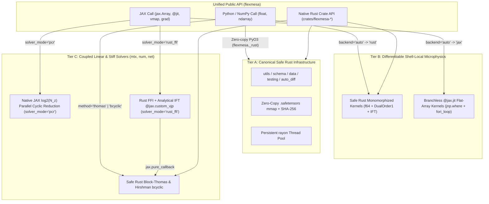

# Hybrid Architecture, Automatic Differentiation & Numerical Solvers

Evaluating stellar structure and evolution models requires coupling shell-local microphysics (equations of state, opacities, and nuclear reaction networks evaluated across thousands of radial shells) with global multi-zone linear algebra (block-tridiagonal Henyey matrix factorizations and stiff time integrators). Traditional Fortran stellar evolution codes face three structural bottlenecks when applied to statistical inference and sensitivity analysis:

1. **Redundant Tangent Propagation Inside Iterative Microphysics**: Propagating a fixed 33-component to 70-component stellar derivative vector through every intermediate bracket search and Newton-Raphson iteration of an internal microphysics solver (such as Time-Dependent Convection or $(P_{\mathrm{gas}}, T)$ equation-of-state inversion) multiplies arithmetic cost by an order of magnitude because only 2 to 6 local thermodynamic variables vary inside that root-finder.
2. **Host-Accelerator Dispatch Overhead**: Calling compiled subroutines zone-by-zone from Python or executing sequential Thomas factorizations across thousands of radial shells on a GPU introduces severe host-device synchronization latency.
3. **Global State and Non-Portable Table Caches**: Mutable Fortran module variables, untyped namelists, and compiler-specific unformatted binary caches complicate parallel ensemble execution and static verification.

`FlexMESA` resolves these bottlenecks by partitioning its codebase into an **Integrated Three-Tier Hybrid Architecture** combining **Safe Rust (`#![forbid(unsafe_code)]`)**, zero-copy **Python (`PyO3`)**, and **JAX (`float64` `@jax.jit` + `jax.vmap`)**, paired with analytical **Implicit Function Theorem** differentiation.

---

## 1. The Three-Tier Hybrid Architecture



### Tier A: Canonical Safe Rust Infrastructure (`schema`, `data`, `testing`, `utils`, `auto_diff`)
Modules that manage configuration schemas (`flexmesa.schema`), binary table caching and cryptographic verification (`flexmesa.data`), golden test output parsing (`flexmesa.testing`), string tokenizers and bounded worker pools (`flexmesa.utils`), and explicit forward-mode hyperdual numbers (`flexmesa.auto_diff`) have a single canonical implementation in Safe Rust (`#![forbid(unsafe_code)]`). Python accesses Tier A directly through the compiled `flexmesa._rust` (`PyO3`) extension, eliminating duplicated parser and loader code.

### Tier B: Differentiable Shell-Local Microphysics (`const`, `math`, `interp_1d`, `interp_2d`, `neu`, `turb`, `chem`, `ionization`, `colors`, `eos`, `kap`, `rates`, `atm`)
Shell-local microphysics and spline interpolation modules provide two synchronized kernels behind a single public dispatcher with `backend="auto" | "rust" | "jax"`:

- **Safe Rust CPU Kernel (`backend="rust"`)**: Monomorphized over the `Real` trait (`f64` and const-generic `DualOrder1<N>`), parallelized across radial shells via a persistent `rayon` worker pool, and exposed to Python via zero-copy `rust-numpy` array views (`as_slice()`).
- **Branchless `@jax.jit` Kernel (`backend="jax"`)**: Pure functional `jnp.float64` array kernel written with `jnp.where` and fixed-step `jax.lax.fori_loop` so that `jax.jit`, `jax.vmap`, `jax.grad`, `jax.jacfwd`, and `jax.hessian` compile into compact XLA HLO kernels without Python loop unrolling or host callbacks.

When `backend="auto"` (the default), `flexmesa._dispatch.resolve_backend` inspects the input arguments in $\mathcal{O}(1)$ time and routes standard Python floats and `numpy.ndarray` inputs zero-copy to `flexmesa._rust`, whereas `jax.Array` and JAX tracers (`jax.core.Tracer`) route to the `@jax.jit` kernel.

### Tier C: Coupled Linear and Stiff Solvers (`mtx`, `num`, `net`, `star`)
Coupled multi-zone linear solvers and stiff ODE/Newton integrators provide both multi-core CPU cyclic reduction and native GPU parallel cyclic reduction, connected via `@jax.custom_vjp` analytical adjoints.

---

## 2. Forward-Mode Dual & Hyperdual Automatic Differentiation (`flexmesa.auto_diff`)

Upstream MESA's `auto_diff` module uses preprocessor templates to generate fixed-size first- and higher-order forward-mode automatic differentiation types (`auto_diff_real_star_order1` with 33 fixed slots). `FlexMESA` replaces preprocessor templates with stack-allocated generic algebraic types in `crates/flexmesa-autodiff` and registered JAX PyTrees in `flexmesa.auto_diff`:

1. **Const-Generic First-Order Dual Numbers (`DualOrder1<N>`)**:
   For a scalar value $v \in \mathbb{R}$ and an $N$-component tangent vector $\nabla v \in \mathbb{R}^N$, any smooth unary function $\phi$ propagates derivatives via the chain rule:

   $$u = (v, \nabla v) \in \mathbb{R} \times \mathbb{R}^N, \qquad \phi(u) = \left(\phi(v),\, \phi'(v)\,\nabla v\right).$$

   Because `N` is parameterized via Rust const generics (`DualOrder1<1>` for 1D splines and scalar root-finders, `DualOrder1<4>` for thermal neutrinos, `DualOrder1<6>` and `DualOrder1<12>` for convective mixing, and `StarAdOrder1` for 3-shell stellar stencils), each routine propagates only its active local independent variables rather than a 33-element stellar tangent vector.
2. **Second-Order Dual Numbers (`AutoDiffReal2VarOrder2` / `DualOrder2`)**:
   Propagates the exact value $f$, gradient $(\partial_x f, \partial_y f)$, and symmetric Hessian $(\partial_{xx} f, \partial_{xy} f, \partial_{yy} f)$ in a single forward pass for 2D thermodynamic and opacity tables parameterized by $(\log_{10} T, \log_{10}\rho)$.
3. **Third-Order Two-Variable Hyperdual Numbers (`AutoDiffReal2VarOrder3` / `Hyperdual3`)**:
   Propagates all 10 partial derivatives up to third order ($\partial_\rho^{a} \partial_T^{b} F$ for $0 \le a + b \le 3$) of the specific Helmholtz free energy $F(\rho, T)$ in a single forward pass. Because pressure $P_{\mathrm{gas}} \propto \partial_\rho F$, entropy $s = -\partial_T F$, and specific heats/adiabatic indices ($c_V, c_P, \chi_\rho, \chi_T, \Gamma_1, \Gamma_3, \nabla_{\mathrm{ad}}$) depend on second derivatives of $F$, third-order hyperdual numbers yield exact first derivatives of all thermodynamic quantities ($\partial c_V / \partial T$, $\partial \Gamma_1 / \partial \rho$) with zero finite-difference truncation error.

---

## 3. Implicit Function Theorem Differentiation (`@jax.custom_vjp`)

Whenever a microphysics module solves a nonlinear root equation $Q(Y, \theta) = 0$ for an internal state variable $Y^*(\theta)$ given stellar shell inputs $\theta$ (such as the superadiabaticity $Y = \nabla_T - \nabla_L$ in Kuhfuss 1986 Time-Dependent Convection or log-density $\log_{10}\rho$ in $(P_{\mathrm{gas}}, T)$ equation-of-state inversion), differentiating through the $K$ bisection and Newton-Raphson iterations wastes $(K - 1)$ full Jacobian evaluations and degrades near bracket boundaries where clamping occurs.

Instead, `FlexMESA` converges $Y^*$ using pure scalar `f64` arithmetic and applies the **Implicit Function Theorem** once at the converged root $Y^*$:

$$\frac{\partial Y^*}{\partial \theta} = -\left(\frac{\partial Q}{\partial Y}\bigg|_{Y^*, \theta}\right)^{-1} \frac{\partial Q}{\partial \theta}\bigg|_{Y^*, \theta}.$$

Similarly, for a coupled block-tridiagonal linear system $A(\theta)\,x = b(\theta)$, differentiating through the forward solver is replaced by a `@jax.custom_vjp` rule (`solver_mode="rust_ffi"`) that solves the transposed block-tridiagonal adjoint system on the backward pass:

$$A^\top \lambda = \bar{x}, \qquad \bar{b} = \lambda, \qquad \bar{A}_{k} = -\lambda_k x_k^\top.$$

---

## 4. Monotonic 1D & Bicubic 2D Spline Interpolation (`interp_1d`, `interp_2d`)

### 4.1 1D Piecewise Cubic Splines (`flexmesa.interp_1d`)
Given strictly monotonic knots $x_0 < x_1 < \dots < x_{n-1}$ and node values $y_i$, `interp_1d` stores 4 cubic coefficients per interval $i$ in C-contiguous shape `(n, 4)` such that for $\Delta x = x - x_i$:

$$P_i(x) = f_{i,0} + \Delta x \left(f_{i,1} + \Delta x \left(f_{i,2} + \Delta x\, f_{i,3}\right)\right), \qquad P_i'(x) = f_{i,1} + \Delta x \left(2 f_{i,2} + 3 \Delta x\, f_{i,3}\right).$$

Three slope-reconstruction stencils are provided across Safe Rust (`flexmesa._rust`) and `@jax.jit`:

- **Steffen (1990) Monotonic Cubic (`interp_pm`)**: Enforces strict piecewise monotonicity because it clamps node slopes $s_i$ to $\operatorname{sign}(d_{i-1/2}) \min(|d_{i-1/2}|, |d_{i+1/2}|, 0.5 |\tilde{s}_i|)$ whenever adjacent secants $d_{i-1/2}, d_{i+1/2}$ agree in sign, and sets $s_i = 0$ at local extrema. Monotonic clamping is required when interpolating sharp nuclear composition fronts during adaptive remeshing so that mass fractions never overshoot into unphysical negative values.
- **Quartic / Lagrange 4-Point Slope Stencils (`interp_m3a`, `interp_m3b`, `interp_m3q`)**: Reconstruct fourth-order interior slopes from a 4-point stencil with optional monotonicity limiting.
- **Conservative Cell-Average Reconstruction (`integrate_values`)**: Reconstructs point values from piecewise-integrated shell averages while preserving total mass and energy integrals.

### 4.2 2D Bicubic Hermite Splines (`flexmesa.interp_2d`)
For rectangular thermodynamic and opacity tables $(x_i, y_j)$ of size $(N_x, N_y)$ (such as $\log_{10}\rho$ vs. $\log_{10}T$ in `eos` and `kap`), `interp_mkbicub_db` solves tridiagonal spline systems along rows and columns to precompute $f$, $f_{xx}$, $f_{yy}$, and $f_{xxyy}$ at each grid node in shape `(nx, ny, 4, 4)`. `interp_evbicub_db` and the pre-validated fast path `interp_evbicub_prevalidated_db` evaluate the 6-tuple $(f, f_x, f_y, f_{xx}, f_{yy}, f_{xy})$ in $\mathcal{O}(\log N_x + \log N_y)$ time.


*Figure 1: The left panel compares Steffen (1990) piecewise monotonic cubic interpolation (`interp_pm`, blue solid curve) against unconstrained 4-point quartic-slope interpolation (`interp_m3b`, orange dash-dotted curve) across a sharp helium mass-fraction step at $m/M_\star = 0.45$, demonstrating how `interp_pm` eliminates Gibbs-type overshoots outside $[0, 1]$. The right panel shows the fourth-order $\mathcal{O}(h^4)$ function error and third-order $\mathcal{O}(h^3)$ gradient convergence of the 2D bicubic Hermite spline (`interp_evbicub_db`) on $f(x, y) = \sin(x)\cos(y)$ across grid resolutions $N \in \{16, 32, 64, 128\}$.*

!!! important "Upstream Fortran Precision Note (`bicub_db.f`)"
    In upstream Fortran MESA's `interp_2d/private/bicub_db.f`, the subroutine `fvbicub_db` omits `implicit none`, leaving its local Hermite basis variables (`xp`, `yp`, `cx`, `cy`, `hx2`, `hy2`, `z36th`) implicitly typed as 32-bit `REAL` (`f32`) and limiting accuracy to $\sim 7 \times 10^{-9}$. Both Safe Rust and Python/JAX in `FlexMESA` evaluate the entire Hermite polynomial basis in full 64-bit IEEE-754 `f64`, achieving $4.0 \times 10^{-16}$ cross-language agreement.

---

## 5. Block-Tridiagonal Henyey Solvers & Stiff Integrators (`mtx`, `num`)

### 5.1 Block-Tridiagonal Linear Solvers (`flexmesa.mtx`)
A 1D stellar evolution Newton step with $N_{\mathrm{zones}}$ radial shells and $N_{\mathrm{var}}$ structure plus composition equations per shell produces a coupled block-tridiagonal linear system:

$$L_k x_{k-1} + D_k x_k + U_k x_{k+1} = b_k, \qquad k \in \{0, \dots, N_{\mathrm{zones}} - 1\}, \quad L_0 = U_{N_{\mathrm{zones}}-1} = 0.$$

`FlexMESA` provides three exact `float64` solvers for this system:

1. **Sequential Block-Thomas (`method="thomas"` in Safe Rust)**: Forward Gaussian elimination with partial pivoting on each $N_{\mathrm{var}} \times N_{\mathrm{var}}$ diagonal pivot block followed by backward substitution ($1.59\,\mathrm{ms}$ at $N_{\mathrm{zones}} = 4096, N_{\mathrm{var}} = 5$).
2. **Hirshman et al. (2010) Odd-Even Block Cyclic Reduction (`method="bcyclic"` in Safe Rust)**: Parallelizes a single block-tridiagonal solve across `rayon` worker threads by normalizing odd multiples $j = (2m + 1)2^s$ in parallel and applying Schur-complement updates to even multiples $k = 2m \cdot 2^s$ across $\lceil \log_2 N_{\mathrm{zones}} \rceil$ levels ($1.02\,\mathrm{ms}$ on 4 threads at $N_{\mathrm{zones}} = 4096$).
3. **Vectorized Parallel Cyclic Reduction (`solver_mode="pcr"` in JAX) & Safe Rust FFI (`solver_mode="rust_ffi"`)**:
   - `solve_block_tridiagonal_jax(..., solver_mode="pcr")` updates all $N_{\mathrm{zones}}$ rows simultaneously in $\lceil \log_2 N_{\mathrm{zones}} \rceil$ fused batched `jnp.linalg.solve` steps (`[L_k, U_k]` and `[D_k, b_k]`), accelerating single-star GPU solves by $218\times$ over sequential `lax.scan` ($7.43\,\mathrm{ms}$ vs. $1619\,\mathrm{ms}$ at $N_{\mathrm{zones}} = 4096$) and batched `jax.vmap` solves to $5.36\,\mathrm{ms}$ per star.
   - `solve_block_tridiagonal_jax(..., solver_mode="rust_ffi")` dispatches the forward pass to `flexmesa._rust.solve_block_tridiag_bcyclic` ($2.76\,\mathrm{ms}$) and differentiates reverse-mode `jax.grad` analytically via `@jax.custom_vjp`.

### 5.2 Root-Finding, Optimization & Stiff ODE Integrators (`flexmesa.num`)
`flexmesa.num` (`crates/flexmesa-num`) implements MESA's scalar root-finders (`safe_root_with_brackets`, `safe_root_with_guess`, `safe_root_without_brackets`, `safe_root_jax`, `brent_safe_zero`, `find0`, `find0_quadratic`, `find_max_quadratic`), Nelder-Mead (`nm_simplex`) and Brent (`brent_local_min`, `brent_global_min`) optimizers, adaptive Simpson's 3/8 quadrature (`integrate`) and Ridders extrapolation differentiation (`dfridr`), explicit Runge-Kutta (`rk2`, `rk4`, `dopri5`, `dop853`), and stiff L-stable Rosenbrock (`rosenbrock_dense`, `rosenbrock_banded` across `RosenbrockVariant` `Ros2`, `Rose2`, `Ros3p`, `Ros3pl`, `Rodas3`, `Rodas4`, `Rodasp`) and damped Newton (`newton_solve_dense`, `newton_solve_banded`, `newton_solve_block_tridiagonal`, `newton_solve_jax`) solvers.

---

## 6. Physical Constants, Schemas & Zero-Copy `.safetensors` Tables

- **CODATA / IAU Physical Constants (`flexmesa.constants` & `crates/flexmesa-const`)**: Exports bit-exact IEEE-754 double-precision (`f64`) CGS constants matching `const/public/const_def.f90` (`STANDARD_CGRAV`, `PLANCK_H`, `CLIGHT`, `KERG`, `BOLTZ_SIGMA`, `CRAD`, `AMU`, `ME`, `MP`, `QE`, `MSUN`, `RSUN`, `LSUN`, `SECYER`), precomputed roots and logarithms (`LN10`, `ONE_THIRD`, `SQRT_2_DIV_3`), and the `MixingType` enumeration.
- **IEEE-754 Math Intrinsics (`flexmesa.math` & `crates/flexmesa-math`)**: Implements 33 elementary and domain-safe intrinsics (`pow`, `powi`, `powm1`, `pow2` to `pow8`, `exp10`, `expm1`, `log1p`, `log2`, `safe_log`, `safe_log10`, `safe_sqrt`, `sinpi`, `cospi`, `tanpi`, `asinpi`, `acospi`, `atanpi`, `sgn`, `heaviside`) polymorphic over scalar `f64`, forward-mode `DualOrder1`, and JAX `jnp.float64` arrays.
- **Typed Schemas & Zero-Copy `.safetensors` Data (`flexmesa.schema`, `flexmesa.data`, `flexmesa.testing`)**: `flexmesa.schema` validates `.defaults` and Fortran namelists; `flexmesa.data` verifies 64-character `SHA-256` digests (`manifest.toml`) and memory-maps C-contiguous `float64` and `int64` `.safetensors` tables directly into Safe Rust and Python; `flexmesa.testing.golden` parses upstream `<pkg>/test/test_output` reference files and verifies $\le 10^{-14}$ relative parity.

=== "Python & JAX (`flexmesa.mtx`, `flexmesa.interp_1d`)"

    ```python
    import jax
    import jax.numpy as jnp
    import numpy as np
    from flexmesa import interp_1d, mtx

    # 1. Monotonic 1D Steffen cubic spline evaluation
    x_knots = np.linspace(0.0, 1.0, 11, dtype=np.float64)
    y_knots = np.where(x_knots >= 0.5, 1.0, 0.0)
    coeffs = interp_1d.interp_pm(x_knots, y_knots)
    vals, slopes = interp_1d.interp_values_and_slopes(
        x_knots, coeffs, np.array([0.25, 0.50, 0.75])
    )

    # 2. Block-tridiagonal Henyey solve on CPU (bcyclic) and GPU (PCR)
    rng = np.random.default_rng(0)
    lblk = rng.uniform(-0.1, 0.1, size=(128, 5, 5))
    dblk = np.broadcast_to(4.0 * np.eye(5), (128, 5, 5)).copy()
    ublk = rng.uniform(-0.1, 0.1, size=(128, 5, 5))
    rhs = rng.uniform(-1.0, 1.0, size=(128, 5))

    x_cpu = mtx.solve_block_tridiagonal(lblk, dblk, ublk, rhs, method="bcyclic")
    x_gpu = mtx.solve_block_tridiagonal_jax(
        jnp.asarray(lblk),
        jnp.asarray(dblk),
        jnp.asarray(ublk),
        jnp.asarray(rhs),
        solver_mode="pcr",
    )
    ```

=== "Safe Rust (`crates/flexmesa-autodiff`, `crates/flexmesa-mtx`)"

    ```rust
    use flexmesa_autodiff::DualOrder1;
    use flexmesa_mtx::solve_block_tridiag_bcyclic;

    fn main() {
        // Propagate exact first-order directional derivative via DualOrder1<2>
        let x = DualOrder1::<2>::independent(2.0, 0);
        let y = DualOrder1::<2>::independent(3.0, 1);
        let f = (x * y).sin() + x.powi(2);
        println!("f = {:.6}, df/dx = {:.6}, df/dy = {:.6}", f.val, f.d1[0], f.d1[1]);
    }
    ```
