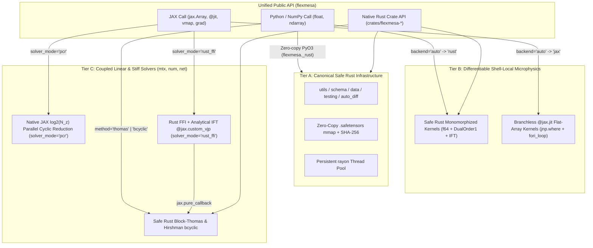

# Design Philosophy and Hybrid Architecture

Upstream Fortran MESA (`r24.08.1`) comprises roughly $4.7 \times 10^5$ lines of Fortran across 21 coupled packages. While MESA's physics coverage is comprehensive, its reliance on preprocessor-generated operator-overloading types (`auto_diff_real_star_order1` with 33 fixed partial-derivative slots), mutable global module state, and 1-based column-major scratch buffers creates three structural bottlenecks for modern astrostatistics and simulation-based inference:

1. **Redundant Derivative Propagation Inside Iterative Solvers**: Propagating 33-to-70 derivative components through every bracket-search and Newton-Raphson step of an internal microphysics solver (`turb_tdc`, `eos`) multiplies arithmetic cost by an order of magnitude even when only 4–6 local thermodynamic variables vary in that routine.
2. **Python / Accelerator Impedance Mismatch**: Calling Fortran subroutines zone-by-zone from Python or attempting to vectorize sequential Thomas factorizations across thousands of radial shells on a GPU introduces severe host-device synchronization and dispatch overhead.
3. **Opaque Global State and Table Formats**: Implicit `implicit real (a-h,o-z)` legacy routines, ad-hoc ASCII cache files, and untyped Fortran namelists hinder reproducibility and static verification.

---

## 1. The Integrated Three-Tier Hybrid Architecture

`FlexMESA` resolves these bottlenecks by partitioning every module into one of three architectural tiers based on its computational and data-flow profile:

### Tier A: Infrastructure, I/O, and Explicit Dual Algebra
Modules that manage configuration schemas (`schema`), binary table caching and checksum verification (`data`), golden test parsing (`testing`), bounded pools (`utils`), and explicit forward-mode hyperdual numbers (`auto_diff`) have a **single canonical implementation in Safe Rust** (`#![forbid(unsafe_code)]`). Python accesses Tier A directly through the compiled `flexmesa._rust` (`PyO3`) extension, eliminating duplicated parser and loader code.

### Tier B: Differentiable Shell-Local Microphysics and Splines
Shell-local microphysics and interpolation modules (`const`, `math`, `interp_1d`, `interp_2d`, `neu`, `turb`, `chem`, `ionization`, `colors`, `eos`, `kap`, `rates`, `atm`) provide two synchronized kernels behind a single public function with `backend="auto" | "rust" | "jax"`:

- **Safe Rust CPU Kernel (`backend="rust"`)**: Monomorphized over `Real` (`f64` and const-generic `DualOrder1<N>`), parallelized across stellar zones via the persistent `rayon` pool, and exposed to Python via zero-copy `rust-numpy` array views (`as_slice()`).
- **Branchless `@jax.jit` Kernel (`backend="jax"`)**: Pure functional `jnp.float64` array kernel using `jnp.where` and fixed-step `jax.lax.fori_loop` so `jax.jit`, `jax.vmap`, `jax.grad`, `jax.jacfwd`, and `jax.hessian` compile into compact XLA HLO kernels without Python loop unrolling or host callbacks.

When `backend="auto"` (the default), `flexmesa._dispatch.resolve_backend` inspects the input arguments in $\mathcal{O}(1)$ time and routes standard Python floats and `numpy.ndarray` inputs zero-copy to `flexmesa._rust`, whereas `jax.Array` and JAX tracers (`jax.core.Tracer`) route to the `@jax.jit` kernel.

### Tier C: Coupled Linear and Stiff Solvers
Coupled multi-zone linear solvers (`mtx`) and stiff ODE/Newton integrators (`num`, `net`) provide both multi-core CPU cyclic reduction and native GPU parallel cyclic reduction:

- **Safe Rust (`method="thomas" | "bcyclic"`)**: Sequential pre-allocated block-Thomas elimination for single-thread efficiency and Hirshman et al. (2010) odd-even block cyclic reduction (`bcyclic`) for parallelizing a single star's Henyey matrix across CPU cores.
- **JAX Parallel Cyclic Reduction (`solver_mode="pcr"`)**: Reduces an $N_{\mathrm{zones}}$-shell block-tridiagonal system in $\lceil \log_2 N_{\mathrm{zones}} \rceil$ vectorized batched `jnp.linalg.solve` steps (12 steps at $N_{\mathrm{zones}} = 4096$ instead of 8192 sequential `lax.scan` steps), running $218\times$ faster on GPU and batching across stellar grids via `jax.vmap`.
- **JAX Safe Rust FFI with Analytical `@jax.custom_vjp` (`solver_mode="rust_ffi"`)**: Invokes `flexmesa._rust.solve_block_tridiag_bcyclic` on the forward pass via `jax.pure_callback` and solves the transposed block-tridiagonal adjoint system $A^\top \lambda = \bar{x}$ in Safe Rust during `jax.grad`.

---

## 2. Implicit Function Theorem Differentiation

Whenever a microphysics module solves a nonlinear root equation $Q(Y, \theta) = 0$ for an internal state variable $Y^*(\theta)$ given stellar shell inputs $\theta$ (such as the superadiabaticity $Y = \nabla_T - \nabla_L$ in Kuhfuss 1986 Time-Dependent Convection), differentiating through the $K$ bisection and Newton-Raphson iterations wastes $(K - 1)$ full Jacobian evaluations and degrades near bracket boundaries where clamping occurs.

Instead, `FlexMESA` converges $Y^*$ using pure scalar `f64` arithmetic and applies the **Implicit Function Theorem** once at the converged root $Y^*$:

$$\frac{\partial Y^*}{\partial \theta} = -\left(\frac{\partial Q}{\partial Y}\bigg|_{Y^*, \theta}\right)^{-1} \frac{\partial Q}{\partial \theta}\bigg|_{Y^*, \theta}.$$

In Safe Rust, this requires only a single evaluation of $Q$ with `DualOrder1<N>` at $Y^*$ after scalar convergence. In JAX, `jax.grad` (or a `@jax.custom_jvp` / `@jax.custom_vjp` rule) evaluates $(\partial Q / \partial Y, \partial Q / \partial \theta)$ at $Y^*$ in one analytical pass.

---

## 3. Memory-Order and Indexing Contract

Every module in `FlexMESA` enforces a strict translation boundary from upstream Fortran MESA's 1-based column-major arrays to 0-based C-contiguous row-major arrays:

| Quantity | Upstream Fortran MESA | FlexMESA (Safe Rust & Python/JAX) |
| :--- | :--- | :--- |
| **Zone index $k$** | `1 .. nz` (`k = 1` surface, `k = nz` center) | `0 .. nz - 1` (`k = 0` surface, `k = nz - 1` center) |
| **1D spline coefficients** | `f(1:4, 1:n)` (column-major) | Shape `(n, 4)` C-contiguous (`f[i, 0..4]`) |
| **2D bicubic spline coefficients** | `f(1:4, 1:4, 1:nx, 1:ny)` | Shape `(nx, ny, 4, 4)` C-contiguous (`f_flat` length `16 * nx * ny`) |
| **Block-tridiagonal Henyey matrix** | `lblk(1:nvar, 1:nvar, 1:nz)` | Shape `(nz, nvar, nvar)` C-contiguous (`lblk[0] = 0`, `ublk[nz - 1] = 0`) |
| **Floating-point precision** | Mixed (`real(dp)` with accidental `real` in legacy `.f`) | Strict IEEE-754 `f64` / `jnp.float64` everywhere |
