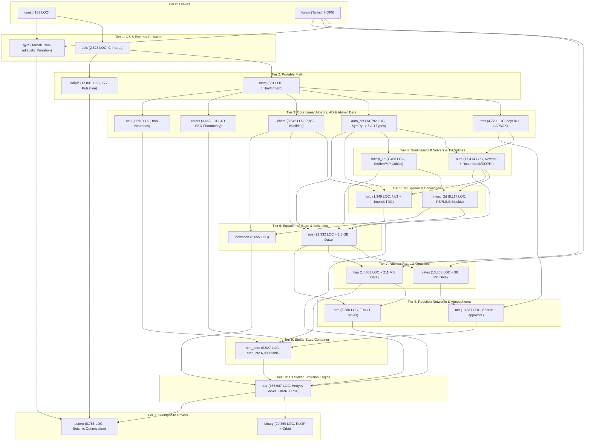
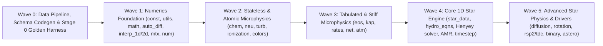

# MESA Codebase Reconnaissance & Large-Scale Migration Strategy (`Rust` / `Python` / `JAX`)

> [!IMPORTANT]
> **Scope at a Glance:** A full checkout of [`MESAHub/mesa`](file:///tmp/mesa-audit) comprises **2,353 tracked source and documentation files** totaling **546,934 lines (404,810 non-blank, non-comment LOC)**, accompanied by **2.18 GiB of Git LFS physics data tables** and two bundled Fortran tarballs (`gyre-9.1.1.tar.gz` at 54,760 lines of `.fypp` and `forum-1.2.3.tar.gz` at 4,219 lines of `.fypp`). Excluding documentation (`.rst`), bundled external codes (`stella`, `adipls`, `gyre`), and legacy X11 plotting (`pgstar`), the core MESA 1D stellar and binary evolution engine and its 20 supporting numerical and microphysics packages represent **~275,000 LOC** organized in a strict **12-tier Directed Acyclic Graph (DAG)** with **21 standalone module unit-test suites** and **107 end-to-end integration test cases**.

---

## 1. Repository-Wide Codebase Census

### 1.1 Line Counts by File Type Across `/tmp/mesa-audit`

The census below classifies every regular (non-symlink) file in [`/tmp/mesa-audit`](file:///tmp/mesa-audit) into executable code lines (`Code LOC`), blank lines, and comment lines (`Total = Code LOC + Blank + Comment`).

| File Category / Extension | File Count | Total Lines | Code LOC | Blank Lines | Comment Lines | Primary Architectural Role |
| :--- | ---: | ---: | ---: | ---: | ---: | :--- |
| **Free-form Fortran (`.f90`, `.F90`)** | 910 | 367,867 | 281,131 | 55,317 | 31,419 | Core MESA modules (`const` through `star`, `binary`, `astero`) |
| **Fixed-form Fortran 77 (`.f`)** | 229 | 97,480 | 65,645 | 5,334 | 26,501 | Legacy solvers (`num`, `interp_2d`, `kap`, `eos`) and external `adipls` (130f) / `stella` (75f) |
| **Fortran Textual Includes (`.inc`)** | 92 | 15,692 | 12,792 | 1,993 | 907 | `star_info` / `binary_info` field definitions, namelists, and `run_star_extras` templates |
| **Fortran Deck Includes (`.dek`, `.incl`, `formats`)** | 83 | 13,491 | 8,880 | 1,397 | 3,214 | Inlined Helmholtz EOS blocks (`eos`), solver callback interfaces (`num`, `mtx`), format strings |
| **C Source & Headers (`.c`, `.h`)** | 2 | 235 | 140 | 41 | 54 | POSIX filesystem helpers (`mkdir -p`, `mv`, `cp`, `is_dir`) in [`utils/private/utils_c_system.c`](file:///tmp/mesa-audit/utils/private/utils_c_system.c) |
| **Python Scripts (`.py`)** | 58 | 11,368 | 8,394 | 2,011 | 963 | `auto_diff` SymPy code generator (`1,671` lines), CI linters (`2,252` lines), plotting/test utilities |
| **Shell & Build Scripts (`.sh`, `#!`, `.mk`)** | 670 | 13,115 | 8,253 | 3,294 | 1,568 | Build system (`make/*.mk`), `./install`, and 535+ test-suite runner scripts (`rn`, `re`, `ck`) |
| **Documentation (`.rst`, excl. 129 symlinks)** | 313 | 27,711 | 19,596 | 8,109 | 6 | Sphinx user/developer documentation (`docs/source/`) and 107 test-suite `README.rst` files |
| **Grand Total (Unpacked Working Tree)** | **2,357** | **546,959** | **404,831** | **77,496** | **64,632** | Complete git checkout (excluding `.defaults` text files and compressed tarballs) |

> [!NOTE]
> **Default Configuration Files (`.defaults` & `.list`):** In addition to the source files above, MESA stores **32,406 lines** of declarative control documentation and default values in `<module>/defaults/*.defaults` and `*.list` files (such as [`star/defaults/controls.defaults`](file:///tmp/mesa-audit/star/defaults/controls.defaults) at 11,810 lines, [`star/defaults/pgstar.defaults`](file:///tmp/mesa-audit/star/defaults/pgstar.defaults) at 7,969 lines, and [`star/defaults/star_job.defaults`](file:///tmp/mesa-audit/star/defaults/star_job.defaults) at 2,958 lines). These files serve simultaneously as human-readable reference documentation (via Sphinx symlinks) and as the canonical specification enforced against Fortran namelists by [`linters/check_defaults.py`](file:///tmp/mesa-audit/linters/check_defaults.py).

---

### 1.2 Per-Package Census Across All 28 MESA Directories

The table below lists all top-level directories in `/tmp/mesa-audit` ordered by their topological build tier (Tiers 0 through 11, followed by standalone external codes and support directories), including counts of files exceeding the `code-migrate` modular budget of `400` LOC.

| Tier | Package / Directory | Source/Doc Files | Total Lines | Code LOC | Blank / Comment | Files > 400 LOC | Files > 1,000 LOC | Disk Size (with LFS Data) | Primary Responsibility |
| ---: | :--- | ---: | ---: | ---: | ---: | ---: | ---: | ---: | :--- |
| **0** | [`const`](file:///tmp/mesa-audit/const) | 3 | 306 | 188 | 60 / 58 | 0 | 0 | 52 KB | CODATA/IAU physical constants, float kinds (`sp`, `dp`, `qp`), mixing enums |
| **0** | [`forum`](file:///tmp/mesa-audit/forum) | Tarball | *(4,672)* | *(~3,500)* | N/A | N/A | N/A | 56 KB | Bundled `forum-1.2.3.tar.gz` (Townsend F2008 HDF5/sorting/string utilities) |
| **1** | [`utils`](file:///tmp/mesa-audit/utils) | 16 | 3,960 | 2,823 | 743 / 394 | 3 | 0 | 188 KB | String/integer hash dicts (`integer_dict`), token parser, NaN traps, C POSIX wrappers |
| **1** | [`gyre`](file:///tmp/mesa-audit/gyre) | 2 + Tarball | 291 *(+58,414)* | 169 | 109 / 13 | 0 | 0 | 5.1 MB | Bundled `gyre-9.1.1.tar.gz` linear non-adiabatic oscillation code + MESA stub |
| **2** | [`math`](file:///tmp/mesa-audit/math) | 7 | 1,020 | 581 | 347 / 92 | 0 | 0 | 72 KB | Bit-reproducible IEEE-754 math (`crmath`/`crlibm`), `powN`, `safe_log`, `pre_z(1:1000)` |
| **2** | [`adipls`](file:///tmp/mesa-audit/adipls) | 134 | 30,988 | 17,831 | 293 / 12,864 | 10 | 2 | 8.3 MB | Bundled Christensen-Dalsgaard F77 adiabatic pulsation package |
| **3** | [`mtx`](file:///tmp/mesa-audit/mtx) | 27 | 6,391 | 4,729 | 766 / 896 | 4 | 1 | 5.8 MB | Parallel block-tridiagonal solver (`bcyclic`), unrolled small-block BLAS/LAPACK (`my_lapack95`) |
| **3** | [`auto_diff`](file:///tmp/mesa-audit/auto_diff) | 20 | 17,066 | 14,792 | 1,914 / 360 | 9 | 7 | 744 KB | SymPy code generator + 8 forward-mode AD Fortran types (`1var_order1` to `2var_order3`, `star_order1(33)`, `tdc`) |
| **3** | [`chem`](file:///tmp/mesa-audit/chem) | 8 | 4,424 | 3,542 | 490 / 392 | 2 | 1 | 3.6 MB | 7,856 nuclides (`isotopes.data`), 24-pt partition functions, 10 solar abundance tables, $\bar{A}, \bar{Z}, Y_e$ |
| **3** | [`colors`](file:///tmp/mesa-audit/colors) | 14 | 5,142 | 3,663 | 925 / 554 | 2 | 0 | 73 MB | 4D stellar atmosphere SED flux cube interpolation (`hermite_interp_vector`) & synthetic photometry |
| **3** | [`neu`](file:///tmp/mesa-audit/neu) | 8 | 2,352 | 1,690 | 488 / 174 | 1 | 1 | 8.7 MB | Itoh et al. (1996) analytical thermal neutrino loss rates across 5 channels (`sneut5`) |
| **4** | [`num`](file:///tmp/mesa-audit/num) | 86 | 25,770 | 17,414 | 2,536 / 5,820 | 9 | 4 | 1.2 MB | Generalized Newton-Raphson solver (`mod_newton`), 7 stiff Rosenbrock/RODAS integrators (`isolve`), DOPRI5/853, Brent/BOBYQA/NEWUOA, `accurate_sum` (`real128`) |
| **4** | [`interp_1d`](file:///tmp/mesa-audit/interp_1d) | 14 | 5,851 | 4,408 | 943 / 500 | 2 | 0 | 280 KB | 1D Steffen (1990) piecewise monotonic (`interp_pm`) & Suresh-Huynh MP cubic splines (`interp_m3*`) |
| **5** | [`interp_2d`](file:///tmp/mesa-audit/interp_2d) | 16 | 16,176 | 8,117 | 2,645 / 5,414 | 8 | 2 | 1.8 MB | 2D PSPLINE bicubic splines (`bicub_db`), 2D Steffen (`bipm_db`), Akima 760, Renka 790 |
| **5** | [`turb`](file:///tmp/mesa-audit/turb) | 8 | 2,354 | 1,349 | 292 / 713 | 0 | 0 | 144 KB | Closed-form Cardano MLT (`mlt.f90`), implicit Time-Dependent Convection (`tdc.f90`), semiconvection, thermohaline |
| **6** | [`eos`](file:///tmp/mesa-audit/eos) | 67 | 30,114 | 22,332 | 4,243 / 3,539 | 19 | 2 | **1.8 GB** | 7-component blended EOS cascade (`CMS > Skye > PC > FreeEOS > OPAL/SCVH > HELM > Ideal`) |
| **6** | [`ionization`](file:///tmp/mesa-audit/ionization) | 23 | 4,012 | 2,655 | 829 / 528 | 1 | 0 | 5.6 MB | Effective ionic charges ($Z_{\text{eff}}$) and ionization potentials for element diffusion |
| **7** | [`rates`](file:///tmp/mesa-audit/rates) | 31 | 18,547 | 13,303 | 3,551 / 1,693 | 9 | 2 | 1.6 MB (+98 MB in `data/`) | NACRE, JINA Reaclib 7-term fits, Salpeter/extended/Chugunov screening, Weaklib/Suzuki & phase-space weak rates |
| **7** | [`kap`](file:///tmp/mesa-audit/kap) | 42 | 20,418 | 14,683 | 3,236 / 2,499 | 13 | 2 | **211 MB** | OPAL Type 1/2, OP, OPLIB, Ferguson, Freedman, Lederer CN, AESOPUS HDF5, Poutanen Compton, Potekhin conduction, OP mono |
| **8** | [`net`](file:///tmp/mesa-audit/net) | 24 | 17,799 | 13,687 | 2,984 / 1,128 | 12 | 5 | 824 KB | Arbitrary sparse reaction networks (`net_derivs.f90` with `real128` sums), hardcoded `approx21`, 1-zone stiff burners |
| **8** | [`atm`](file:///tmp/mesa-audit/atm) | 21 | 7,225 | 5,280 | 1,284 / 661 | 4 | 0 | 14 MB | 4 $T(\tau)$ relations (uniform/varying opacity), Guillot irradiated atmospheres, 7 Castelli/PHOENIX/WD table sets |
| **9** | [`star_data`](file:///tmp/mesa-audit/star_data) | 15 | 7,064 | 5,527 | 1,097 / 440 | 4 | 2 | 380 KB | `type(star_info)` God-object definition (6,008 fields/controls/hooks) and `star_handles(10)` registry |
| **10** | [`star`](file:///tmp/mesa-audit/star) | 630 | 201,897 | 156,647 | 31,062 / 14,188 | 98 | 39 | **126 MB** | 1D stellar evolution engine (133.6k LOC in `private/`, including 23.1k LOC `pgstar` and 10.4k LOC `rsp`) + 91 test cases |
| **11** | [`binary`](file:///tmp/mesa-audit/binary) | 96 | 26,014 | 20,359 | 3,561 / 2,094 | 13 | 1 | 3.1 MB | Binary orbit evolution, explicit/implicit Roche-lobe overflow, tides, CE, winds, `pgbinary` + 8 test cases |
| **11** | [`astero`](file:///tmp/mesa-audit/astero) | 42 | 11,824 | 8,755 | 2,268 / 801 | 6 | 3 | 3.5 MB | Asteroseismic model fitting ($\chi^2$ optimization via Simplex/BOBYQA/NEWUOA coupled to GYRE/ADIPLS) + 8 test cases |
| **Ext** | [`stella`](file:///tmp/mesa-audit/stella) | 110 | 45,371 | 36,778 | 1,720 / 6,873 | 24 | 9 | 50 MB | Standalone legacy F77 radiation-hydrodynamics supernova light-curve code (not in `make/subdirs.mk`) |
| **Support** | [`data`](file:///tmp/mesa-audit/data), [`docs`](file:///tmp/mesa-audit/docs), [`scripts`](file:///tmp/mesa-audit/scripts), [`linters`](file:///tmp/mesa-audit/linters), [`make`](file:///tmp/mesa-audit/make) | 228 | 21,626 | 15,442 | 5,817 / 367 | 7 | 1 | 182 MB | Runtime data caches, Sphinx docs (319 `.rst` files incl. symlinks), custom CI linters, and GNU Make build rules |

---

### 1.3 Top 15 Largest Source Files in MESA

| Rank | File Path | Package | Total Lines | Code LOC | Architectural Role |
| ---: | :--- | :--- | ---: | ---: | :--- |
| 1 | [`star/private/pgstar_ctrls_io.f90`](file:///tmp/mesa-audit/star/private/pgstar_ctrls_io.f90) | `star` | 6,567 | 6,286 | `&pgstar` Fortran namelist binding and `s% pg` struct copy boilerplate |
| 2 | [`stella/vladsf/y12m.f`](file:///tmp/mesa-audit/stella/vladsf/y12m.f) | `stella` | 5,643 | 4,091 | Legacy Fortran 77 Y12M sparse matrix solver inside standalone STELLA |
| 3 | [`rates/private/ratelib.f90`](file:///tmp/mesa-audit/rates/private/ratelib.f90) | `rates` | 4,619 | 3,213 | Hardcoded analytical thermonuclear reaction rate fits (NACRE / Caughlan-Fowler) |
| 4 | [`star/private/relax.f90`](file:///tmp/mesa-audit/star/private/relax.f90) | `star` | 4,215 | 3,524 | Pseudo-evolution model relaxation routines (mass, composition, entropy, $\Omega$, core) |
| 5 | [`star/private/ctrls_io.f90`](file:///tmp/mesa-audit/star/private/ctrls_io.f90) | `star` | 4,195 | 3,490 | Main `&controls` Fortran namelist I/O and transfer into `star_info` (1,422 controls) |
| 6 | [`star/private/star_utils.f90`](file:///tmp/mesa-audit/star/private/star_utils.f90) | `star` | 4,162 | 3,587 | Core utility routines for coordinate, energy, virial, and Jacobian partial unpacking |
| 7 | [`stella/src/stl/rad_photo_cross_section.f90`](file:///tmp/mesa-audit/stella/src/stl/rad_photo_cross_section.f90) | `stella` | 4,034 | 3,811 | Photoionization cross-section tables in standalone STELLA |
| 8 | [`stella/vladsf/phfit2.f`](file:///tmp/mesa-audit/stella/vladsf/phfit2.f) | `stella` | 3,856 | 3,829 | Verner et al. (1996) analytic photoionization cross-section routine in STELLA |
| 9 | [`star/private/rsp_step.f90`](file:///tmp/mesa-audit/star/private/rsp_step.f90) | `star` | 3,834 | 3,178 | Radial Stellar Pulsations (RSP; Smolec & Moskalik 2008) nonlinear hydro timestepper |
| 10 | [`star/job/run_star_support.f90`](file:///tmp/mesa-audit/star/job/run_star_support.f90) | `star` | 3,669 | 3,014 | Top-level `run1_star` driver loop, `&star_job` execution, and step lifecycle |
| 11 | [`star/private/history.f90`](file:///tmp/mesa-audit/star/private/history.f90) | `star` | 3,510 | 3,113 | Evaluation and formatting of 544 `history.data` output columns |
| 12 | [`interp_2d/private/bicub_db.f`](file:///tmp/mesa-audit/interp_2d/private/bicub_db.f) | `interp_2d` | 3,487 | 1,817 | Double-precision PSPLINE 2D bicubic spline construction and evaluation |
| 13 | [`auto_diff/private/auto_diff_real_2var_order3_module.f90`](file:///tmp/mesa-audit/auto_diff/private/auto_diff_real_2var_order3_module.f90) | `auto_diff` | 3,410 | 3,212 | Code-generated 2-variable, 3rd-order forward AD module (used by `eos/skye`) |
| 14 | [`net/private/net_approx21.f90`](file:///tmp/mesa-audit/net/private/net_approx21.f90) | `net` | 3,374 | 2,546 | Hardwired 21-isotope $\alpha$-chain + H/He nuclear network with analytic Jacobian |
| 15 | [`star/public/star_lib.f90`](file:///tmp/mesa-audit/star/public/star_lib.f90) | `star` | 3,332 | 2,578 | Public procedural API surface of `libstar.a` |

---

## 2. 12-Tier Module Dependency Graph & Reproducibility Architecture

### 2.1 Topological Dependency DAG

Every MESA module in [`make/subdirs.mk`](file:///tmp/mesa-audit/make/subdirs.mk) declares its internal dependencies (`INTERNAL_DEPENDS_ON`) and external libraries (`EXTERNAL_DEPENDS_ON`), generating a `pkg-config` specification (`mesa-<module>.pc`). This forms a strict 12-tier Directed Acyclic Graph:

### 2.2 How MESA Enforces Cross-Platform Bit-for-Bit Reproducibility

A central design invariant of MESA (documented in the MESA V and VI instrument papers and enforced in [`make/compile-settings-gnu.mk`](file:///tmp/mesa-audit/make/compile-settings-gnu.mk)) is that any simulation or unit test must produce **bit-for-bit identical floating-point results** across Linux and macOS, across x86_64 and ARM64, and across varying OpenMP thread counts:

1. **Disabled FMA Contraction (`-ffp-contract=off -fno-sign-zero`)**: [`make/compile-settings-gnu.mk`](file:///tmp/mesa-audit/make/compile-settings-gnu.mk#L15) disables hardware Fused Multiply-Add contraction so `(a * b) + c` rounds identically after multiplication and addition on every CPU architecture.
2. **Correctly Rounded Elementary Functions (`crmath` / `crlibm`)**: Standard system `libm` implementations differ by $0.5\text{ to }4\text{ ULP}$ across glibc, Apple `libSystem`, and Intel SVML. MESA routes all transcendental evaluations (`exp`, `log`, `log10`, `pow`, trig/hyperbolic functions) through [`math/public/math_lib_crmath.f90`](file:///tmp/mesa-audit/math/public/math_lib_crmath.f90), which wraps `crlibm` to guarantee IEEE-754 correct rounding ($< 0.5\text{ ULP}$). The Fortran `**` operator is banned by code style in favor of `pow(x, y)` and `pow2(x)`..`pow8(x)` ([`math/private/math_pown.f90`](file:///tmp/mesa-audit/math/private/math_pown.f90)).
3. **Quad-Precision (`real128`) & Compensated Summation**:
   - In [`net/private/net_derivs.f90`](file:///tmp/mesa-audit/net/private/net_derivs.f90), nuclear reaction rate tendencies $\dot{Y}_i$ and heating $\epsilon_{\text{nuc}}$ are accumulated in 128-bit quad precision (`real(qp)`) before converting back to `real(dp)`. Near nuclear statistical equilibrium (NSE) at $T \gtrsim 3\times 10^9\text{ K}$, forward photodisintegration $(A, \gamma)B$ and reverse $B(\gamma, A)$ rates exceed $10^{15}\text{ s}^{-1}$ while their net difference is orders of magnitude smaller; standard `float64` accumulation suffers catastrophic cancellation.
   - In [`num/public/accurate_sum.f90`](file:///tmp/mesa-audit/num/public/accurate_sum.f90) and `star` (`accurate_auto_diff_real_star_order1`), residual terms in the momentum and energy equations are accumulated via **Neumaier (1974) compensated summation** so sum order does not perturb the Newton residual.
4. **Deterministic Zone Reductions**: OpenMP parallel loops over radial zones ($k = 1 \dots \text{nz}$) write into zone-indexed arrays (`s% equ(:, k)`, `s% dblk(:, :, k)`), and global reductions occur sequentially in deterministic zone order.

---

## 3. Deep Architectural Anatomy: Codegen, State, Microphysics & Solver

### 3.1 Forward-Mode Automatic Differentiation (`auto_diff`)

Instead of hand-coding partial derivatives for stellar structure equations and modern microphysics, MESA uses a SymPy-based Python code generator ([`auto_diff/python/`](file:///tmp/mesa-audit/auto_diff/python/), 9 files, 1,196 LOC) that reads declarative YAML configs ([`auto_diff/config/*.config`](file:///tmp/mesa-audit/auto_diff/config/)) and emits **8 operator-overloaded Fortran modules** (14,188 lines in [`auto_diff/private/`](file:///tmp/mesa-audit/auto_diff/private/)):

| Generated Fortran AD Type | Independent Variables & Derivative Order | Scalar `real(dp)` Words per Value | Primary Consumers in MESA | Target Migration Equivalent (`JAX` / `Rust`) |
| :--- | :--- | ---: | :--- | :--- |
| `auto_diff_real_1var_order1` | 1 scalar, 1st order (`val`, `d1val1`) | 2 | 1D root-finders and local utilities | `jax.jvp` / Rust `Dual64` |
| `auto_diff_real_2var_order1` | 2 scalars, 1st order (`val`, `d1val1`, `d1val2`) | 3 | $(\ln\rho, \ln T)$ partials in `kap`, `eos/pc`, `rates/screen_chugunov`, `rates/eval_ecapture`, `interp_1d/2d` | `jax.value_and_grad` or `jax.jacfwd` / Rust `DualVec64<2>` |
| `auto_diff_real_2var_order2` | 2 scalars, 2nd order (val + gradient + Hessian) | 6 | Bivariate second derivatives | `jax.hessian` / `jax.jet` |
| `auto_diff_real_2var_order3` | 2 scalars, **3rd order** (`val` + 2 1st + 3 2nd + 4 3rd partials) | 10 | [`eos/private/skye.f90`](file:///tmp/mesa-audit/eos/private/skye.f90) and [`eos/private/ideal.f90`](file:///tmp/mesa-audit/eos/private/ideal.f90): differentiates Helmholtz free energy $F(\rho, T)$ to 3rd order to obtain $P, S, E$ (1st), $c_V, c_P, \chi_\rho, \chi_T, \Gamma_1, \nabla_{\text{ad}}$ (2nd), and their $(\ln\rho, \ln T)$ solver Jacobian partials (3rd) | Nested `jax.jvp` or `jax.experimental.jet` / Rust 3rd-order bivariate jet struct |
| `auto_diff_real_4var_order1` | 4 scalars, 1st order | 5 | 4-variable local equations in `eos/pc` | `jax.jacfwd` / Rust `DualVec64<4>` |
| `auto_diff_real_star_order1` | 1 array of length **33**, 1st order (`val`, `d1Array(1:33)`) | 34 | Core `star` hydro equations (`hydro_*.f90`) and `turb` (`mlt.f90`, `semiconvection.f90`): tracks derivatives with respect to 11 structure variables across cells $(k-1, k, k+1)$ | `jax.vmap(jax.jacfwd(cell_residual))` over 3-cell stencil / Rust `DualVec64<33>` |
| `auto_diff_real_tdc` | 1 scalar $Z$ + 1 array (`1:33`), mixed 2nd order (`val`, `d1val1`, `d1Array(33)`, `d1val1_d1Array(33)`) | 68 | [`turb/private/tdc.f90`](file:///tmp/mesa-audit/turb/private/tdc.f90): solves local Newton root $Q(Z; x_{1..33}) = 0$ and uses mixed partials $\partial^2 Q / \partial Z \partial x_j$ to propagate implicit-function-theorem derivatives $\partial Z^* / \partial x_j = -(\partial Q/\partial x_j)/(\partial Q/\partial Z)$ | `jax.custom_root` (implicit differentiation) / Rust implicit dual root wrapper |
| `auto_diff_real_15var_order1` | 1 array of length 15, 1st order | 16 | Legacy 15-variable stencil type (compiled but unused in public interface) | Deprecated / omit |

---

### 3.2 Textual Include Metaprogramming & Legacy Fortran Hazards

Scanning all 1,313 Fortran files reveals both modern software practices (`100%` `implicit none` across all 910 `.f90` files, `0` `equivalence` statements in `.f90` files, `100%` named OpenMP critical sections) and four structural legacy hazards that make the Fortran codebase difficult to read and maintain:

1. **2,480 Textual `include` Statements Across 175 Include Files (`29,183` lines)**:
   - **Dual-Included Namelist/Struct Files**: Because Fortran cannot bind a `NAMELIST` to fields of a dynamically allocated pointer (`type(star_info), pointer :: s`), MESA defines all 1,422 `&controls` variables in [`star_data/private/star_controls.inc`](file:///tmp/mesa-audit/star_data/private/star_controls.inc), all 458 `&star_job` variables in [`star_job_controls.inc`](file:///tmp/mesa-audit/star_data/private/star_job_controls.inc), and all 2,957 `&pgstar` variables in [`pgstar_controls.inc`](file:///tmp/mesa-audit/star_data/private/pgstar_controls.inc). Each `.inc` file is textually included inside `type(star_info)` and included a second time at module scope inside `ctrls_io.f90` / `star_job_ctrls_io.f90` / `pgstar_ctrls_io.f90` (totaling 12,444 lines of hand-maintained copy-in/copy-out boilerplate).
   - **Monolithic Inlined Physics Decks**: [`eos/private/helm.f90`](file:///tmp/mesa-audit/eos/private/helm.f90) textually includes 10 `.dek` files (`3,334` lines) into a single subroutine body so hundreds of local scalar variables share function scope without argument lists.
2. **The 6,008-Member `star_info` God-Object (`star_data`)**:
   - [`star_data/public/star_data_def.f90`](file:///tmp/mesa-audit/star_data/public/star_data_def.f90) combines persistent state (`star_data_step_input.inc`, 149 fields), per-step workspace arrays (`star_data_step_work.inc`, 903 fields), callback procedure pointers (`star_data_procedures.inc`, 88 hooks), `&controls` parameters (`1,422` fields), `s% job` (`458` fields), and `s% pg` (`2,957` fields) into a single derived type accessed globally via `star_handles(1:10)` and `call star_ptr(id, s, ierr)`.
3. **Raw Fortran `pointer` Aliasing vs. `allocatable` (`6,647` vs. `404`)**:
   - Across the codebase, Fortran `pointer` declarations outnumber safe `allocatable` arrays by **16.5 to 1** (`3,673` pointers in `star` alone). In [`star/private/alloc.f90`](file:///tmp/mesa-audit/star/private/alloc.f90), MESA手動 slices pre-allocated 1D work buffers into 2D/3D zone pointer views to avoid reallocation overhead during adaptive mesh refinement (`nz` resizing), creating pervasive pointer aliasing and lifetime hazards.
4. **Module-Level Mutable State & Lazy Table Locks (`1,055` module variables, `109` OpenMP critical locks)**:
   - While zone evaluations run in parallel across OpenMP threads (`92` `!$omp parallel do` loops), `eos`, `kap`, `rates`, `net`, and `atm` store loaded spline tables in module-level global structures guarded by `109` named `!$omp critical` locks. Additionally, [`kap/private/op_load.f`](file:///tmp/mesa-audit/kap/private/op_load.f) retains 4 Fortran 77 `COMMON /mesh/` and `COMMON /cimesh/` blocks with `SAVE` statements, forcing [`kap/private/op_eval.f90`](file:///tmp/mesa-audit/kap/private/op_eval.f90) to serialize all Opacity Project monochromatic evaluations behind `!$omp critical (kap_op_mono)`.

---

### 3.3 Microphysics & Data Table Architecture (`2.18 GiB` LFS Footprint)

| Package | Compressed LFS Data | Runtime Spline & Physics Algorithms | Statefulness & Migration Readiness |
| :--- | :--- | :--- | :--- |
| **`neu`** | `0 B` (8.85 MB golden test output) | **Itoh et al. (1996)** thermal neutrino losses across 5 channels (`pair`, `plasmon`, `photoneutrino`, `bremsstrahlung`, `recombination`) with rational Fermi-Dirac fits and analytical $(\rho, T, \bar{A}, \bar{Z})$ derivatives. | **100% Stateless** (`1,690` LOC). Zero tables, zero globals. Ideal first microphysics kernel. |
| **`turb`** | `0 B` | **Closed-form Cardano cubic MLT** (`Cox`, `Henyey`, `ML1`, `ML2`, `Mihalas`), **Kuhfuss (1986) implicit 1-eqn TDC** (bisection + damped Newton in `auto_diff_real_tdc`), Langer semiconvection, and Kippenhahn/Traxler/Brown thermohaline mixing. | **100% Stateless** (`1,349` LOC). Zero tables, zero globals; native 33-var AD throughout (except `thermohaline`, where AD partials are currently dropped in Fortran). |
| **`chem`** | `2.8 MB` (`isotopes.data`, `lodders03.data`) | 7,856 nuclides with masses, spins, binding energies, and 24-point partition functions $G(T_9)$; 10 solar abundance tables (`AG89` through `AAG21`, `MB22`); `get_composition_info` computing $(\bar{A}, \bar{Z}, Y_e, \langle Z^2 \rangle, \langle Z^{5/3}\rangle)$ and $\partial/\partial X_i$. | **Immutable Table + Stateless Reductions** (`3,542` LOC). Pack `isotopes.data` into a static `.safetensors` / `.npy` / Rust `const` table. |
| **`eos`** | **`1.71 GB`** (`eosFreeEOS` 1.3 GB, `helm_table` 238 MB, `eosDT` 153 MB, `eosCMS` 15 MB) | **7-component cascade** (`CMS > Skye > PC > FreeEOS > OPAL/SCVH > HELM > Ideal`) joined by **$C^2$ quintic smoothersteps** $\alpha(s) = 10s^3 - 15s^4 + 6s^5$. `Skye` minimizes free energy $F(\rho, T, \{x_i\})$ on the fly using 3rd-order AD (`2var_order3`) with softmin liquid-solid phase blurring; `HELM` uses biquintic Hermite splines (9 coeffs/node); `FreeEOS`/`OPAL`/`SCVH` use PSPLINE bicubic splines on $(\log Q, \log T)$. `eosPT_get` inverts $\log P_{\text{gas}}(\log\rho, \log T)$ via 1D Newton-Brent. | **Split Analytic vs. Tabular** (`22,332` LOC): `Ideal`, `HELM` (1 table), `PC`, and `Skye` cover degenerate/stellar interiors with only `helm_table.dat` and native 3rd-order AD. Tabulated `FreeEOS`/`OPAL` become pure 4D tensor lookups once pre-packed. |
| **`kap`** | **`186 MB`** (`kap_data` 109 MB, `kap_input` 43 MB, `AESOPUS` 34 MB) | High-$T$ (OPAL Type 1 & C/O-enhanced Type 2, OP, OPLIB) + Low-$T$ (Ferguson, Freedman, Lederer CN, AESOPUS HDF5) radiative tables on $(\log R, \log T)$ blended via $C^2$ quintic smoothersteps, combined with **Poutanen (2017) relativistic Compton scattering** and **Potekhin/Blouin electron conduction** (`condint.f90`). | **Pre-Packable Spline Tensor + Analytic Tails** (`14,683` LOC). Packing the active $(Z, X, \log R, \log T, 4)$ bicubic coefficients into contiguous memory eliminates all 26 OpenMP critical table-loading locks. |
| **`rates`** | **`98 MB`** (`data/rates_data/`: Reaclib, Weaklib, Suzuki tables) | 106 hardcoded NACRE/CF88 rates (`ratelib.f90`), JINA Reaclib 7-parameter fits cached on a 10,001-point $\log T$ cubic spline grid, Weaklib/Suzuki bilinear $(T_9, \log\rho Y_e)$ tables, on-the-fly relativistic Fermi phase-space electron capture (`eval_ecapture.f90`), and 3 Coulomb screening modes (`salpeter`, `extended` Graboske/Itoh, `chugunov` WKB pycnonuclear). | **Vectorizable Over `(n_zones, n_reactions)`** (`13,303` LOC). In JAX or SIMD Rust, direct 7-term Reaclib evaluation is compute-bound and faster than L3-cache-missing spline lookups. |
| **`net`** | `352 KB` (`data/net_data/nets/`) | Arbitrary sparse networks (`net_derivs.f90`, accumulating $\dot{Y}$ and $\epsilon_{\text{nuc}}$ in **`real128` quad precision** near NSE), hardcoded 21-isotope `approx21` (`net_approx21.f90`), and 1-zone stiff Rosenbrock/Bader-Deuflhard burners (`net_burn*.f90`). | **Requires `f64x2` (Double-Double) or `f128` Sum Kernel** (`13,687` LOC). On GPU/JAX (where hardware `fp128` is absent), Knuth/Dekker `float64` double-double (`f64x2`) arithmetic preserves exact 106-bit significand precision near NSE. |
| **`atm`**, **`ionization`**, **`colors`** | `92 MB` (`colors` 73 MB, `atm` 14 MB, `ion` 5 MB) | `atm`: 4 analytic $T(\tau)$ relations (uniform fixed-point or `dopri5` varying-$\kappa$ ODE), Guillot irradiated grey atmosphere, and 7 $(T_{\text{eff}}, \log g, [Z/H])$ table sets. `colors`: 4D Hermite spectral flux cube interpolation + Simpson filter integration. | **Surface / Post-Processing Modules** (`11,598` LOC combined). `atm` only evaluates at surface zone $k=1$; `colors` is a pure post-processing 4D tensor kernel. |

---

### 3.4 The `star` 1D Stellar Evolution Engine (`133,590` LOC in `star/private/`)

The 144 files in [`star/private/`](file:///tmp/mesa-audit/star/private/) decompose into 8 distinct functional subsystems:

| Subsystem in `star/private/` | Files | Total Lines | Share of `star/private/` | Core Files & Algorithms |
| :--- | ---: | ---: | ---: | :--- |
| **1. Step Driver, Init, Relaxation & Mass Change** | 17 | 25,173 | 18.8% | [`evolve.f90`](file:///tmp/mesa-audit/star/private/evolve.f90), [`struct_burn_mix.f90`](file:///tmp/mesa-audit/star/private/struct_burn_mix.f90), [`alloc.f90`](file:///tmp/mesa-audit/star/private/alloc.f90), [`relax.f90`](file:///tmp/mesa-audit/star/private/relax.f90), [`adjust_mass.f90`](file:///tmp/mesa-audit/star/private/adjust_mass.f90), [`star_utils.f90`](file:///tmp/mesa-audit/star/private/star_utils.f90) |
| **2. Timestep Control, Models, Photos & Namelist/Log I/O** | 15 | 23,927 | 17.9% | [`timestep.f90`](file:///tmp/mesa-audit/star/private/timestep.f90) (54 controllers + digital filter), [`ctrls_io.f90`](file:///tmp/mesa-audit/star/private/ctrls_io.f90), [`history.f90`](file:///tmp/mesa-audit/star/private/history.f90) (544 cols), [`profile_getval.f90`](file:///tmp/mesa-audit/star/private/profile_getval.f90) (605 cols), [`read_model.f90`](file:///tmp/mesa-audit/star/private/read_model.f90), [`photo_in.f90`](file:///tmp/mesa-audit/star/private/photo_in.f90) |
| **3. PGSTAR Live X11/PNG Plotting (Legacy UI)** | 40 | 23,132 | 17.3% | [`pgstar_ctrls_io.f90`](file:///tmp/mesa-audit/star/private/pgstar_ctrls_io.f90) (6,567 lines) + 39 PGPLOT panel modules (`pgstar_kipp.f90`, `pgstar_hr.f90`, etc.) |
| **4. Mixing, Convection, Rotation, Diffusion & Winds** | 24 | 19,156 | 14.3% | [`mix_info.f90`](file:///tmp/mesa-audit/star/private/mix_info.f90), [`diffusion.f90`](file:///tmp/mesa-audit/star/private/diffusion.f90) (Burgers eqns + Paquette coeffs + radiative levitation), [`conv_premix.f90`](file:///tmp/mesa-audit/star/private/conv_premix.f90), [`predictive_mix.f90`](file:///tmp/mesa-audit/star/private/predictive_mix.f90), [`rotation_mix_info.f90`](file:///tmp/mesa-audit/star/private/rotation_mix_info.f90), [`phase_separation.f90`](file:///tmp/mesa-audit/star/private/phase_separation.f90), [`winds.f90`](file:///tmp/mesa-audit/star/private/winds.f90) |
| **5. Coupled Hydro/Structure Equations & Henyey Solver** | 20 | 17,001 | 12.7% | [`star_solver.f90`](file:///tmp/mesa-audit/star/private/star_solver.f90), [`hydro_vars.f90`](file:///tmp/mesa-audit/star/private/hydro_vars.f90), [`hydro_eqns.f90`](file:///tmp/mesa-audit/star/private/hydro_eqns.f90), [`hydro_momentum.f90`](file:///tmp/mesa-audit/star/private/hydro_momentum.f90), [`hydro_energy.f90`](file:///tmp/mesa-audit/star/private/hydro_energy.f90), [`hydro_temperature.f90`](file:///tmp/mesa-audit/star/private/hydro_temperature.f90), [`hydro_chem_eqns.f90`](file:///tmp/mesa-audit/star/private/hydro_chem_eqns.f90), [`hydro_riemann.f90`](file:///tmp/mesa-audit/star/private/hydro_riemann.f90), [`star_bcyclic.f90`](file:///tmp/mesa-audit/star/private/star_bcyclic.f90) |
| **6. Radial Stellar Pulsations (RSP) & Pulse Export** | 16 | 14,256 | 10.7% | 7 Smolec & Moskalik (2008) 1D nonlinear pulsation files (`10,371` lines) + 9 pulsation format exporters (`FGONG`, `GYRE`, `OSC`, `GSM`) |
| **7. Adaptive Mesh Refinement (AMR)** | 6 | 7,036 | 5.3% | [`adjust_mesh.f90`](file:///tmp/mesa-audit/star/private/adjust_mesh.f90), [`mesh_plan.f90`](file:///tmp/mesa-audit/star/private/mesh_plan.f90), [`adjust_mesh_split_merge.f90`](file:///tmp/mesa-audit/star/private/adjust_mesh_split_merge.f90), [`mesh_adjust.f90`](file:///tmp/mesa-audit/star/private/mesh_adjust.f90) |
| **8. Per-Cell Microphysics Wrappers** | 6 | 3,909 | 2.9% | [`micro.f90`](file:///tmp/mesa-audit/star/private/micro.f90), [`eos_support.f90`](file:///tmp/mesa-audit/star/private/eos_support.f90), [`kap_support.f90`](file:///tmp/mesa-audit/star/private/kap_support.f90), [`net.f90`](file:///tmp/mesa-audit/star/private/net.f90), [`atm_support.f90`](file:///tmp/mesa-audit/star/private/atm_support.f90), [`neu.f90`](file:///tmp/mesa-audit/star/private/neu.f90) |

> [!TIP]
> **Key Scope Reduction Insight inside `star/private/`:** Nearly **40% of `star/private/` (`53,500+` lines)** is NOT the core stellar evolution solver! Specifically, `pgstar` (`23,132` lines of PGPLOT X11 wrappers), namelist/column I/O boilerplate (`18,849` lines across `ctrls_io.f90`, `star_job_ctrls_io.f90`, `history.f90`, `profile_getval.f90`, `star_history_def.f90`, `star_profile_def.f90`), and the legacy Smolec `rsp_*` subsystem (`10,371` lines, which is actively being superseded by `TDC` + `hydro_rsp2.f90`) account for **52,352 lines**. The actual mathematical core of `star` (hydro/structure equations, damped Newton-Raphson solver, block-tridiagonal cyclic reduction, mixing, diffusion, AMR, and timestep control) is **~65,000 lines**.

---

## 4. Two-Tier Verification Oracle (`make check` & `test_suite`)

MESA provides a built-in two-tier verification hierarchy that maps directly onto the [`code-migrate`](file:///mnt/d/Dropbox/.agents/skills/code-migrate/SKILL.md) Verification Crucible and Two-Tier Parity Oracle:

### 4.1 Tier 1: Standalone Module Unit Tests (`<pkg>/test/`)
- **Coverage**: **21 of the 25 build modules** have standalone unit test executables (`build/<module>/bin/checker`, totaling **58 Fortran test files / 20,618 LOC**) that run during `./install` via [`make/check.mk`](file:///tmp/mesa-audit/make/check.mk) without requiring `star`.
- **Golden Baselines**: Each module compares `checker` stdout against `<pkg>/test/test_output` (**18,885 lines / 9.36 MB** of 16-digit `1pe24.16` golden reference values) using exact `diff -b` (or `ndiff -relerr 1e-6` for `gyre`).
- **Strategic Value for Migration**: Every Tier 0 through Tier 8 module (`const`, `utils`, `math`, `mtx`, `auto_diff`, `num`, `interp_1d`, `interp_2d`, `chem`, `colors`, `neu`, `turb`, `eos`, `ionization`, `rates`, `kap`, `net`, `atm`) can be migrated, unit-tested, property-tested, and verified to $\le 10^{-12}$ relative error against its own `<pkg>/test/test_output` golden file in complete isolation!

### 4.2 Tier 2: End-to-End Integration Test Suites (`107` Active Cases + `32` Dev Cases)
- **Inventory**:
  - [`star/test_suite/`](file:///tmp/mesa-audit/star/test_suite): **91 active test cases** covering low/intermediate-mass evolution (21), massive stars & core-collapse/pair-instability SNe (13), white dwarfs & neutron stars (15), convection/mixing/rotation/diffusion/Riemann hydro (14), radial stellar pulsations & GYRE-in-MESA (15), and microphysics/network/hook tests (13), plus **32 developer test cases** (`dev_cases_*`).
  - [`binary/test_suite/`](file:///tmp/mesa-audit/binary/test_suite): **8 active test cases** (`double_bh`, `wind_fed_bhhmxb`, `star_plus_point_mass`, `star_plus_point_mass_explicit_mdot`, `evolve_both_stars`, `jdot_ml_check`, `jdot_gr_check`, `jdot_ls_check`).
  - [`astero/test_suite/`](file:///tmp/mesa-audit/astero/test_suite): **8 active test cases** (`example_astero`, `fast_newuoa`, `fast_scan_grid`, `fast_simplex`, `fast_from_file`, `astero_adipls`, `astero_gyre`, `surface_effects`).
- **6 Pass/Fail Gates in `each_test_run`**:
  1. Clean compilation (`make`).
  2. Zero exit code (`./rn`).
  3. Zero bytes written to `stderr` (`err.txt` empty, verified with `-ffpe-trap=invalid,overflow,zero -finit-real=snan` when FPE checks are active).
  4. Target physical assertion / termination string matched in `out.txt` (`extras_after_evolve` checks core masses, surface abundances, pulsation periods, and `log_rel_run_E_err`).
  5. Final `.mod` model file created.
  6. **Bit-for-bit Photo Restart Invariant**: Restarting from an intermediate checkpoint photo (`./re x<N>`) must produce an **identical MD5 checksum** for the final `.mod` file as the uninterrupted run (`./ck`).

---

## 5. Target Language & Framework Tradeoff Analysis (`Rust` vs. `Python` vs. `JAX`)

Evaluating MESA's 12 tiers against Safe Rust (`#![forbid(unsafe_code)]`), Python (`NumPy/SciPy/Numba`), and JAX (`float64` + XLA) reveals that MESA comprises **two fundamentally different computational workloads**:

| Architectural Dimension | Safe Rust (`f64`, Rayon, SIMD, `faer`) | Pure JAX (`float64`, `@jax.jit`, `vmap`, `custom_root`) | Python Orchestration (`PyO3` / `equinox` / `pydantic`) |
| :--- | :--- | :--- | :--- |
| **1. Forward & Higher-Order Autodiff (`auto_diff`, `eos/skye`, `turb/tdc`, `star` 33-var stencil)** | Requires generic dual/hyper-dual traits (`num-dual` or custom generated jet structs for `1var_order1`..`2var_order3` and `DualVec<33>`). Explicit, zero-allocation, and predictable on CPU. | **Native superpower**: `jax.jvp`, `jax.jacfwd`, `jax.experimental.jet` (for 3rd-order `skye` free energy), and `jax.custom_root` (for implicit `TDC` and `eosPT` root-finding) replace all 14,188 lines of `auto_diff` codegen automatically. | Exposes clean differentiable Python callables to `dynesty`, `telescopic`, `cd_sbi`, and `Stellax`. |
| **2. Zone-Parallel Microphysics & Spline Tables (`neu`, `turb`, `eos`, `kap`, `rates`)** | Fast multi-threaded CPU execution via Rayon + AVX-512/NEON SIMD; trivial memory-mapped (`mmap`) binary `.bin` / `.safetensors` table loading; deterministic `core_math` IEEE-754 parity. | **Massive GPU/CPU vectorization**: `jax.vmap` over `nz` zones (or across batches of $10^3$ stars simultaneously) fuses bicubic spline lookups, $C^2$ quintic blends, and Reaclib rates into a single XLA kernel on the RTX 5080 (16 GB VRAM). | High-level table configuration, caching, and diagnostic plotting. |
| **3. Quad-Precision (`real128`) NSE Sums (`net_derivs.f90`) & Compensated Sums (`accurate_sum`)** | Native software `f128` or zero-cost `dd`/`qd` (`f64x2` double-double) structs with exact IEEE rounding control (`-ffp-contract=off` equivalent). | XLA lacks native `float128` on GPU, so `net_derivs` and `accurate_sum` must use a **pure JAX Dekker/Knuth `f64x2` (double-double) PyTree** (two `float64` arrays providing 106 bits of significand precision). | Transparent wrapper. |
| **4. Block-Tridiagonal Solver (`mtx/bcyclic`, `star_bcyclic`)** | **Ideal on CPU**: Parallel cyclic reduction (`bcyclic`) or Thomas algorithm over `(nz, nvar, nvar)` blocks in pre-allocated `SolverWorkspace` slices (`0` heap allocations, L1/L2 cache-resident small-matrix LU). | On GPU/XLA, sequential Thomas has depth $O(\text{nz})$, whereas **Parallel Cyclic Reduction (`jax.lax.associative_scan` or tree reduction over $\lceil\log_2 \text{nz}\rceil$ steps)** parallelizes across zones for padded fixed-size grids (`nz_max`, e.g., 2048 or 4096). | Dispatches to Rust CPU solver or JAX GPU solver. |
| **5. Dynamic Adaptive Mesh Refinement (`adjust_mesh`), Retries/Backups & File I/O** | **Ideal in Rust**: Splitting/merging zones dynamically resizes `nz` every step; complex stateful heuristics (`mesh_plan`, `conv_premix`, `predictive_mix`), binary checkpointing, and `.mod` parsing run with zero JIT recompilation overhead. | Dynamic array shapes (`nz` changing by $\pm 5\text{--}50$ zones per step) trigger **XLA shape recompilation** unless all zone arrays are padded to fixed bucket sizes (e.g., `nz_pad in {1024, 2048, 4096}`) with boolean active-zone masks. | Ideal for replacing 12,444 lines of Fortran namelist I/O with Pydantic/TOML/YAML + legacy `inlist` parser and `py_mesa_reader`-compatible HDF5/Parquet output. |
| **6. Differentiating Through Stellar Evolution ($\partial \text{Observables} / \partial \theta$)** | Differentiating across an entire Henyey step requires explicit adjoint linear solves ($\mathbf{J}^T \lambda = -\partial L/\partial x$). | **End-to-end differentiableHeney step**: By wrapping the converged Newton-Raphson step in `jax.custom_root(f_residual, x_init, solve_henyey, tangent_solve=solve_block_tridiag_transpose)`, JAX gives exact analytical gradients through an entire stellar evolution step via the Implicit Function Theorem without unrolling Newton iterations in memory! | Enables gradient-based asteroseismic inversion (`astero`), HMC (`telescopic`), and SBI (`cd_sbi` / `Stellax`). |

### Recommended Target Architecture: **Dual-Layer Rust Core + JAX Differentiable Physics (`mesa-rs` + `jax-mesa`)** (or Unified Rust/Python Architecture)

Rather than forcing dynamic I/O, adaptive remeshing, and legacy file parsers into XLA or giving up JAX's automatic differentiation and GPU batching for microphysics and stellar structure, the cleanest modern architecture separates MESA into **three clean layers**:

1. **Layer 1: Modernized Data & Schema Layer (Rust + Python/Safetensors/HDF5)**:
   - Convert MESA's 2.18 GiB of ASCII / unformatted Fortran `.bin` caches and `.defaults` files into **portable, memory-mappable `.safetensors` / HDF5 spline coefficient tensors** (pre-computed once with exact PSPLINE bicubic and Steffen 1D coefficients) and **declarative schema definitions** (auto-generating typed Rust structs and Python Pydantic/Equinox classes from `*.defaults`, eliminating 18,000+ lines of `.inc` and `ctrls_io.f90` boilerplate).
2. **Layer 2: Pure Functional Microphysics & Stencil Equations (JAX `float64` & Safe Rust Parity Kernels)**:
   - Implement Tiers 0 through 8 (`const`, `math`, `interp_1d`, `interp_2d`, `chem`, `neu`, `turb`, `eos`, `kap`, `rates`, `net`, `atm`, `colors`) as **100% stateless, pure functions** over contiguous SoA arrays (`<= 400` LOC per file).
   - In **Rust**, this provides a zero-dependency, memory-safe, multi-threaded CPU engine with bit-identical `crlibm`/`core_math` parity and Python bindings via `PyO3`.
   - In **JAX (`float64`)**, the exact same stateless mathematical equations and pre-fitted spline tensors run under `@jax.jit` and `jax.vmap` on the RTX 5080 GPU with native 1st-, 2nd-, and 3rd-order autodiff (`jax.jacfwd`, `jax.jet`, `jax.custom_root`).
3. **Layer 3: Modular 1D Stellar & Binary Evolution Engine (`star` & `binary`)**:
   - Replace the 6,008-field `star_info` God-object and its 3,673 raw Fortran pointers with a **hierarchical, owned state architecture**:
     - `StarConfig` (immutable physics/solver controls parsed from `inlist` or Python/TOML),
     - `StarState` (persistent step-input arrays: `nz`, `mstar`, `dq`, `xh`, `xa`, `j_rot`, `conv_vel`, `w`, covering the 149 fields needed for exact checkpoint restarts),
     - `SolverWorkspace` (pre-allocated SoA buffers and block-tridiagonal `lblk`, `dblk`, `ublk` matrices),
     - Trait/Callable Physics Hooks (replacing the 88 `nopass` Fortran procedure pointers with typed Rust traits and Python/JAX callables).

---

## 6. Multi-Session, Multi-Agent Execution Strategy (`6 Waves`)

Because MESA's 12-tier dependency DAG is strictly acyclic and **every module from Tier 0 to Tier 8 has its own standalone golden unit test (`<pkg>/test/test_output`)**, we can execute this migration across multiple sessions using **wave-parallel subagent teams** where no agent ever builds on unverified foundations:

| Wave | Target MESA Modules | Source Code LOC (Excl. Boilerplate) | Parallel Subagent Workstreams | Verification Gate (`code-migrate` Crucible) |
| :--- | :--- | ---: | :--- | :--- |
| **Wave 0: Infrastructure, SDK & Schema Codegen** | `make`, `linters`, `defaults`, `data` caches | ~5,000 LOC (replaces ~30,000 LOC of `.inc`/`ctrls_io`) | **Agent 0A**: Install MESASDK / `gfortran` + `ndiff` + `rustc` on `speagle-desktop` and capture Stage 0 golden baselines. **Agent 0B**: Build Python/Rust parser for `*.defaults` & `*_columns.list` to auto-generate typed config structs and `inlist` parser. **Agent 0C**: Build binary cache converter exporting MESA `.bin` spline tables to `.safetensors` / HDF5. | All 21 MESA Fortran module unit tests run and log `stage1_baseline` in `migration_telemetry.json`; schema codegen passes all 4 MESA linters (`check_defaults`, `check_columns`, `check_photos`). |
| **Wave 1: Foundational Numerics (Tiers 0–5)** | `const`, `utils`, `math`, `auto_diff`, `interp_1d`, `interp_2d`, `mtx`, `num` | ~53,000 LOC (reduces to ~12,000 LOC with native AD/generics) | **Agent 1A**: `const`, `utils`, `math` (`crlibm`/IEEE-754 parity + `pre_z`). **Agent 1B**: `interp_1d` (Steffen/MP cubics) & `interp_2d` (PSPLINE bicubic, Akima, Renka). **Agent 1C**: `mtx` (`bcyclic` parallel block-tridiagonal + small-block LU) & `num` (`mod_newton`, Rosenbrock/RODAS `isolve`, `dopri5/853`, Brent/BOBYQA/NEWUOA, `accurate_sum`). **Agent 1D**: Dual/Jet AD types (`1var_order1`..`2var_order3`, `star_order1(33)`, `tdc`). | Match `const`, `utils`, `math`, `auto_diff`, `interp_1d`, `interp_2d`, `mtx`, and `num` golden `test_output` baselines (`1,885` lines) to $\le 10^{-12}$ + `proptest`/`hypothesis` fuzzing. |
| **Wave 2: Stateless & Atomic Microphysics (Tiers 3 & 5)** | `chem`, `neu`, `turb`, `ionization`, `colors` | ~12,900 LOC | **Agent 2A**: `chem` (7,856 nuclides, partition functions, solar abundances, composition moments). **Agent 2B**: `neu` (Itoh et al. 5-channel thermal neutrinos). **Agent 2C**: `turb` (Cardano MLT, implicit Kuhfuss TDC with AD, semiconvection, thermohaline with upgraded AD). **Agent 2D**: `ionization` & `colors` (4D Hermite SED flux cube + synthetic photometry). | Match `chem` (`2,635` lines), `neu` (`10,000` lines), `turb` (`55` lines), `ionization` (`43` lines), and `colors` (`234` lines) golden `test_output` baselines + autodiff `check_grads`. |
| **Wave 3: Tabulated & Stiff Microphysics (Tiers 6–8)** | `eos`, `kap`, `rates`, `net`, `atm` | ~69,300 LOC | **Agent 3A (`eos`)**: Analytic `Ideal`, `HELM`, `PC`, and `Skye` (3rd-order AD + softmin phase blur) + tabulated `FreeEOS`/`OPAL`/`SCVH`/`CMS` with $C^2$ quintic blends and `eosPT` root inversion. **Agent 3B (`kap` & `atm`)**: Type 1/2 OPAL/OP/Ferguson/AESOPUS splines, Poutanen Compton, Potekhin conduction, and $T(\tau)$/table atmospheres. **Agent 3C (`rates` & `net`)**: NACRE/Reaclib rates, Salpeter/extended/Chugunov screening, Weaklib/Suzuki/phase-space weak rates, `approx21`, and sparse `net_derivs` (`f64x2`/`f128` NSE sums) + 1-zone stiff burners. | Match `eos` (`474` lines), `kap` (`78` lines), `rates` (`3,191` lines), `net` (`214` lines), and `atm` (`101` lines) golden `test_output` baselines + GPU/CPU 4-stage throughput benchmarks. |
| **Wave 4: Core 1D `star` Hydro/Henyey Engine (Tiers 9–10a)** | `star_data` + core `star` (`hydro_*`, `star_solver`, `star_bcyclic`, `mix_info`, `adjust_mesh`, `timestep`, `evolve`) | ~55,000 LOC | **Agent 4A**: `StarState`, `StarConfig`, `SolverWorkspace`, `.mod` & binary photo I/O. **Agent 4B**: Coupled 3-zone stencil `hydro_vars` & `hydro_eqns` (continuity, momentum, radius, energy, temperature, chem) + 33-var Jacobian assembly. **Agent 4C**: Damped Newton-Raphson Henyey solver (`star_solver`) + `star_bcyclic` + implicit adjoint differentiation wrapper. **Agent 4D**: Local/non-local mixing (`mix_info`, overshoot), AMR (`adjust_mesh`), and 54-controller `timestep` + `evolve` retry/redo loop. | Pass `star/test` smoke test + foundational `star/test_suite` benchmarks (`1M_pre_ms_to_wd`, `7M_prems_to_AGB`, `15M_dynamo`, `wd_cool_0.6M`, `make_zams`) including exact photo-restart checksum parity. |
| **Wave 5: Advanced `star` Physics, `binary` & `astero` (Tiers 10b–11)** | Advanced `star` (`diffusion`, `rotation`, `conv_premix`, `predictive_mix`, `riemann`, `rsp2`) + `binary` + `astero` | ~55,000 LOC | **Agent 5A**: Element diffusion (`diffusion*.f90` Burgers solver + radiative levitation) & shellular rotation (`hydro_rotation`, `rotation_mix_info`, `solve_omega_mix`). **Agent 5B**: Convective premixing (`conv_premix`), `predictive_mix`, white dwarf `phase_separation`, HLLC `hydro_riemann`, and `hydro_rsp2`. **Agent 5C (`binary`)**: Dual-star wrapper, explicit/implicit RLOF `binary_mdot`, tides, CE, and orbital angular momentum. **Agent 5D (`astero` & Pulsation Export)**: FGONG/GYRE/OSC exporters + asteroseismic $\chi^2$ optimization (upgraded from Nelder-Mead/BOBYQA to gradient-based optimization where JAX is active). | Scale across the full 107-case integration test suite (`91 star`, `8 binary`, `8 astero`). |

---

### Recommended Exclusions / Modern Replacements (Saving ~98,000 LOC of Legacy Baggage)

1. **`star/private/pgstar_*.f90` & `binary/private/pgbinary_*.f90` (`~26,000` LOC)**: MESA's PGPLOT X11/PNG plotting subsystem (`40` files in `star` + `pgbinary`) is tightly coupled to 1980s Fortran PGPLOT primitives. Replace with a lightweight Python/Matplotlib/Plotly live telemetry dashboard consuming `history`/`profile` streams (styled via [`plot-style`](file:///mnt/d/Dropbox/.agents/skills/plot-style/SKILL.md)).
2. **`stella/` (`45,371` lines / `36,778` LOC)**: Standalone legacy Fortran 77 radiation-hydrodynamics code (`1,938` `common` blocks, `1,405` `goto` statements, not even built in `make/subdirs.mk`). Keep out of scope unless radiation-hydro supernova light curves are specifically needed later.
3. **`adipls/` (`30,988` lines / `17,831` LOC) & `gyre/` (`58,414` lines in tarball)**: Both are external stellar oscillation packages bundled into MESA. Export standard `GYRE` / `FGONG` in-memory arrays or files (via `pulse_gyre` / `pulse_fgong` in `3,885` LOC) or build a native differentiable adiabatic pulsation solver in JAX/Rust rather than porting 130 legacy F77 `adipls` files line-by-line.
