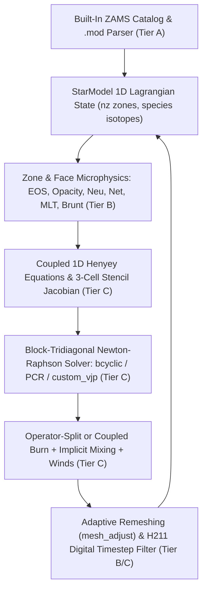

# Wave 4 1D Stellar Structure & Evolution Specification (`star_data` & `star`)

Wave 4 ports the 1D Lagrangian hydrostatic and hydrodynamic stellar evolution engine (`star_data` and `star`, corresponding to `crates/flexmesa-star`, `crates/flexmesa-py/src/star_py.rs`, and `src/flexmesa/star/`) within the **Integrated Three-Tier Hybrid Architecture**.

---

## 1. Three-Tier Hybrid Architecture Mapping

1. **Tier A (`StarModel` State, `.mod` / `ZAMS` I/O, and History/Profile Diagnostics)**:
   - Canonical memory-safe ownership in `crates/flexmesa-star` (`#![forbid(unsafe_code)]`) with flat contiguous `Vec<f64>` zone arrays (`lnd`, `ln_t`, `ln_r`, `lum`, `dq`, `xa`) indexed from outer surface ($k = 0$) to inner core ($k = \mathrm{nz} - 1$).
   - Built-in binary Zero-Age Main Sequence (`ZAMS`) catalog (`crates/flexmesa-star/data/zams_z2m2_y28_subset.bin`) covering $M \in \{0.51, 1.0, 2.0, 3.0, 4.0, 5.0, 10.0, 15.0\}\,M_\odot$ at $Z = 0.02$ with piecewise-linear interpolation in $\log_{10}(M/M_\odot)$ and conservative mass-overlap remapping (`interp_q`).
2. **Tier B (Zone/Face Microphysics, Mesh Gradient Function, and Timestep Filters)**:
   - Safe Rust CPU kernels (`hydro_vars`, `brunt`, `mix_info`, `overshoot`, `winds`, `mesh_adjust`, `timestep`) paired with branchless `@jax.jit` flat-array kernels (`eval_face_mlt_and_brunt_jax`, `eval_mesh_gval_jax`, `eval_varcontrol_jax`, `eval_h211_timestep_jax`).
3. **Tier C (Coupled 1D Henyey Equations, Block-Tridiagonal Newton Solver, and Evolutionary Driver)**:
   - Safe Rust provides `eval_henyey_equations`, damped Newton-Raphson `solve_henyey_step` backed by sequential block-Thomas (`solve_block_tridiagonal`) or 4-thread Hirshman et al. (2010) odd-even cyclic reduction (`solve_block_tridiag_bcyclic`), `do_struct_burn_mix`, and `star_evolve`.
   - Python/JAX provides `@jax.jit` `eval_hydro_residuals_jax`, automatic block-tridiagonal Jacobian assembly (`eval_hydro_system_jax`), native $\lceil \log_2 N_{\mathrm{zones}} \rceil$ Parallel Cyclic Reduction (`solver_mode="pcr"`), and zero-copy Safe Rust `bcyclic` FFI bindings equipped with analytical Implicit Function Theorem `jax.custom_vjp` rules (`solver_mode="rust_ffi"`).

---

## 2. Lagrangian Indexing, Primary Variables, and 3-Cell Stencil AD

Each stellar model is discretized into $\mathrm{nz}$ concentric spherical shells indexed $k \in \{0, 1, \dots, \mathrm{nz} - 1\}$ from surface ($k = 0$, $q_0 = 1$) to center ($k = \mathrm{nz} - 1$):

$$\Delta m_k = M_\star \Delta q_k, \qquad \overline{\Delta m}_k = \begin{cases} \tfrac{1}{2} \Delta m_0, & k = 0, \\ \tfrac{1}{2}(\Delta m_{k-1} + \Delta m_k), & 1 \le k < \mathrm{nz}. \end{cases}$$

The primary structure variables per zone are `i_lnd` ($\ln\rho_k$, cell center), `i_lnt` ($\ln T_k$, cell center), `i_lnr` ($\ln r_k$, outer face), and `i_lum` ($L_k$, outer face), optionally followed by `i_v` ($v_k$), `RSP2` turbulent speed and face scale height (`i_w`, `i_hp`), and $\mathrm{species}$ nuclear mass fractions $X_{j,k}$ (`basic.net`: ${}^1\mathrm{H}, {}^3\mathrm{He}, {}^4\mathrm{He}, {}^{12}\mathrm{C}, {}^{14}\mathrm{N}, {}^{16}\mathrm{O}, {}^{20}\mathrm{Ne}, {}^{24}\mathrm{Mg}$).

Local face and cell equations depend on primary variables in at most three adjacent shells ($k - 1$, $k$, and $k + 1$). `StarAdOrder1` (`crates/flexmesa-star/src/star_ad.rs`) propagates a 24-component first-order tangent vector across the 3-cell stencil (`m1`, `00`, `p1` for `lnd`, `lnt`, `lnr`, `lum`, `v`, `w_div_wc`, `w`, `hp`), assembling exact diagonal (`dblk`), sub-diagonal (`lblk`), and super-diagonal (`ublk`) Jacobian blocks in a single forward pass.

---

## 3. Coupled 1D Henyey Equations & Block-Tridiagonal Newton-Raphson Solver

At each evolutionary timestep $\Delta t$, `eval_henyey_equations` evaluates the dimensionless residual vector $\mathbf{F}(\mathbf{x}) = \mathbf{0}$ across all $\mathrm{nz}$ shells:

1. **Continuity / Volume Equation (`do1_density_eqn`)**:

   $$R_{\rho,k} = \ln\!\left(\frac{r_k^3 - r_{k+1}^3}{3 \Delta m_k / (4\pi \rho_k)}\right) = 0, \qquad r_{\mathrm{nz}} = R_{\mathrm{center}}.$$

2. **Hydrostatic / Hydrodynamic Momentum Equation (`do1_momentum_eqn`)**:

   $$R_{P,k} = \frac{\ln P_{k-1} - \ln P_k}{\overline{P}_k} + \frac{4\pi r_k^4 \overline{P}_k}{G m_{\mathrm{grav},k} \overline{\Delta m}_k}\left(\frac{G m_{\mathrm{grav},k} \overline{\Delta m}_k}{4\pi r_k^4 \overline{P}_k} + \frac{a_k}{4\pi r_k^2 \overline{P}_k}\right) = 0.$$

3. **Radiative / Convective Temperature Transport Equation (`do1_temperature_eqn`)**:

   $$R_{T,k} = (\ln T_{k-1} - \ln T_k) - \nabla_{T,k} (\ln P_{k-1} - \ln P_k) = 0,$$

   with surface boundary conditions ($k = 0$) enforcing optical-depth atmosphere tables or $T(\tau)$ relations (`ln_peos_surf_ad`, `ln_t_surf_ad`).
4. **Thermal Energy Conservation Equation (`do1_energy_eqn`)**:

   $$R_{L,k} = \frac{L_k - L_{k+1}}{\Delta m_k} - \left(\epsilon_{\mathrm{nuc},k} - \epsilon_{\nu,k} + \epsilon_{\mathrm{grav},k}\right) = 0, \qquad \epsilon_{\mathrm{grav},k} = -T_k c_{P,k}\left[\left(1 - \nabla_{\mathrm{ad},k}\chi_{T,k}\right)\frac{\delta\ln T_k}{\Delta t} - \nabla_{\mathrm{ad},k}\chi_{\rho,k}\frac{\delta\ln\rho_k}{\Delta t}\right].$$

5. **Coupled Nuclear Burning & Convective Mixing Equations (`do1_chem_eqns`)**:

   $$R_{X_{j,k}} = \frac{X_{j,k} - X_{j,k}^{\mathrm{start}}}{\Delta t} - \dot{X}_{j,k}^{\mathrm{nuc}} - \frac{1}{\Delta m_k}\left[\sigma_k (X_{j,k-1} - X_{j,k}) - \sigma_{k+1}(X_{j,k} - X_{j,k+1})\right] = 0.$$

Each Newton-Raphson iteration solves the scaled block-tridiagonal linear system:

$$\mathbf{L}_k\,\delta\tilde{\mathbf{x}}_{k-1} + \mathbf{D}_k\,\delta\tilde{\mathbf{x}}_k + \mathbf{U}_k\,\delta\tilde{\mathbf{x}}_{k+1} = -\mathbf{F}_k, \qquad \delta\mathbf{x}_k = \alpha\,\mathrm{diag}(\mathbf{x}_{\mathrm{scale},k})\,\delta\tilde{\mathbf{x}}_k,$$

with domain damping $\alpha \in (0, 1]$ (`compute_corr_coeff`) preventing unphysical density, temperature, radius, surface luminosity, or mass-fraction excursions.

---

## 4. Convective Boundaries, Winds, Adaptive Remeshing & Timestep Control

- **Convective Boundaries & Overshooting (`mix_info`, `overshoot`)**: Sub-cell zero-crossing interpolation of $y_k = \nabla_{\mathrm{rad},k} - \nabla_{\mathrm{ad},k}$ locates exact convective boundaries, removes small mixing glitches (`clean_mixing_glitches`), applies step or exponential diffusive overshooting ($D_{\mathrm{ov}}(dr) = D_0 \exp[-2\,dr / (f_{\mathrm{ov}} H_{P,\mathrm{bdy}})]$), and computes Lagrangian face coupling coefficients $\sigma_k = \min[(4\pi r_k^2 \rho_{\mathrm{face},k})^2 D_k / \overline{\Delta m}_k, \alpha_{\max}\overline{\Delta m}_k/\Delta t]$.
- **Mass-Loss Winds (`winds`)**: Implements Reimers (1975), Blöcker (1995), Vink et al. (2001, including bi-stability jump), de Jager et al. (1988), Nieuwenhuijzen & de Jager (1990), and composite `Dutch` wind prescriptions with proportional super-Eddington enhancement.
- **Adaptive Mesh Adjustment (`mesh_adjust`)**: Evaluates the monotonically increasing dimensionless mesh spacing function $g_k$ (`eval_mesh_gval`), plans cell splits ($\Delta g_k > \mathrm{mesh\_max\_allowed\_ratio}$) and merges ($\Delta g_{k-1} + \Delta g_k < \mathrm{mesh\_min\_allowed\_ratio}$), and remaps $\ln\rho, \ln T, L, X_{j,k}$ via conservative mass-overlap interpolation (`interp_q`) while reconstructing $\ln r_k$ from enclosed volume integration.
- **Timestep Controller (`timestep`, `evolve`)**: Combines the 5-point boxcar-smoothed relative structure variation norm `varcontrol`, nuclear fuel depletion limits (`dX_nuc_drop`), luminosity and effective-temperature change caps, and the Söderlind & Wang (2006) second-order H211B digital filter (`eval_h211_timestep`).
