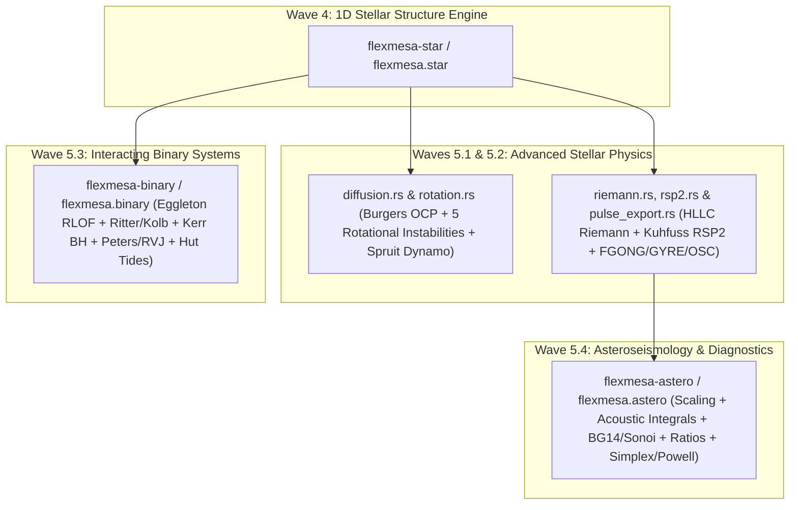

# Wave 5 Advanced Stellar Physics, Interacting Binaries & Asteroseismology Specification

Wave 5 completes the **25-module MESA dependency DAG** in `FlexMESA` by porting advanced 1D stellar transport, non-linear hydrodynamics and radial pulsation equations, interacting binary star evolution (`binary`), and asteroseismic diagnostics and model fitting (`astero`) across the **Three-Tier Hybrid Architecture** (`Safe Rust + Python/PyO3 + JAX`).

---

## 1. Architectural Placement in the Three-Tier Hybrid Stack

| Sub-Wave | Upstream Fortran MESA Scope | Tier Assignment | Safe Rust Implementation | Python & JAX Implementation |
| :--- | :--- | :--- | :--- | :--- |
| **Wave 5.1** | `star/private/diffusion_*.f90`, `paquette_coeffs.f90`, `phase_separation.f90`, `hydro_rotation.f90`, `mix_rot.f90`, `magnetic_diffusion.f90` | **Tier B + Tier C** | `crates/flexmesa-star/src/diffusion.rs` & `rotation.rs`: Burgers multi-fluid solver, Caplan et al. (2022) OCP $D^*(\Gamma, \kappa)$, phase separation, Roche $(f_P, f_T)$, 5 rotational instabilities (`DSI`, `SH`, `SSI`, `ES`, `GSF`), and Spruit-Tayler (2002) dynamo | `flexmesa.star.jax_diffusion_rot`: `@jax.jit` kernels `eval_burgers_velocities_jax`, `eval_caplan_ocp_dstar_jax`, `eval_omega_crit_jax`, `eval_rotation_fp_ft_jax`, `eval_rotational_mixing_zone_jax` |
| **Wave 5.2** | `star/private/hydro_riemann.f90`, `rsp2.f90`, `turbulent_ina.f90`, `pulse_fgong.f90`, `pulse_gyre.f90`, `pulse_osc.f90` | **Tier A + Tier B** | `crates/flexmesa-star/src/riemann.rs`, `rsp2.rs`, & `pulse_export.rs`: Well-balanced 1D spherical HLLC Riemann solver, Kuhfuss (1986) / Smolec & Moskalik (2008) `RSP2` turbulent energy equation, Dziembowski $(V, V_g, A^*, U, c_1)$, and `FGONG`/`GYRE`/`OSC` exporters | `flexmesa.star.jax_hydro_pulse`: `@jax.jit` kernels `eval_hllc_face_jax`, `eval_hllc_surface_face_jax`, `eval_riemann_momentum_residual_jax`, `solve_stationary_rsp2_w_jax`, `eval_rsp2_zone_jax`, `eval_dziembowski_variables_jax` |
| **Wave 5.3** | `binary/private/binary_*.f90` (`rlobe`, `mdot`, `edot`, `jdot`, `tides`, `wind`, `evolve`) | **Tier B + Tier C** | `crates/flexmesa-binary/`: Eggleton (1983) Roche lobe, Ritter (1988) & Kolb & Ritter (1990) RLOF, implicit Bisection-Brent $\dot{M}_{\mathrm{tr}}$ solver, Lu et al. (2023) $L_2$ loss, Bardeen (1972) Kerr BH spin & Eddington accretion, Peters (1964) GR $\dot{J}_{\mathrm{gr}}$, RVJ (1983) magnetic braking, and Hut (1981) tides | `flexmesa.binary`: `BinarySystem` coupled evolution wrapper plus `@jax.jit` kernels (`eval_rlobe_jax`, `eval_ritter_mdot_thin_jax`, `solve_roche_lobe_mdot_jax`, `eval_bh_spin_and_edd_jax`, `eval_jdot_gr_jax`, `eval_jdot_mb_jax`, `eval_edot_tidal_hut_jax`) |
| **Wave 5.4** | `astero/src/astero_support.f90`, `echelle_plot.f90`, `simplex_search_data.f90`, `bobyqa_*.f90` | **Tier B + Tier C** | `crates/flexmesa-astero/`: Asymptotic & solar-scaled $\Delta\nu, \nu_{\max}, \nu_{\mathrm{ac}}, \Delta\Pi_1$, acoustic radius/depth integrals, BCZ & He II glitch depths, 5 surface corrections (`kjeldsen`, `cubic`, `combined`, `power_law`, `sonoi`), ratios $(r_{01}, r_{10}, r_{02})$, composite $\chi^2$, and Nelder-Mead / Powell / grid drivers | `flexmesa.astero`: Unified dispatcher plus `@jax.jit` kernels (`eval_acoustic_profile_jax`, `eval_delta_nu_asymptotic_jax`, `eval_delta_nu_scaling_jax`, `eval_nu_max_jax`, `eval_cubic_corr_jax`, `eval_combined_corr_jax`, `eval_ratios_r01_r10_jax`, `eval_ratios_r02_jax`, `eval_astero_chi2_jax`) |

---

## 2. Verification & Parity Contract

1. **Upstream Fortran MESA Test Suite Oracles**:
   - **Wave 5.1**: Verified against analytical Burgers multi-fluid equilibrium, Caplan et al. (2022) strong-coupling one-component plasma fits, C/O white-dwarf phase separation shifts, Roche distortion polynomials, and Heger et al. (2000) / Spruit (2002) rotational instability and dynamo thresholds ($\le 10^{-14}$ cross-backend parity).
   - **Wave 5.2**: Verified against hydrostatic well-balanced HLLC Riemann contact states ($\le 10^{-15}$ velocity residual at rest), stationary Kuhfuss (1986) `RSP2` turbulent energy roots, and standard `FGONG` (`ivers = 1300`), `GYRE` (`version 101`), and `OSC` pulsation structure roundtrips.
   - **Wave 5.3**: Verified against `binary/test/test_output` (`test_binary.f90`: `2.0 Msun + 1.4 Msun` at `P = 0.5 d`, relative error $\le 10^{-12}$ across `separation`, `rl_1`, `rl_2`, `rl_gap_1`, `jdot_gr`, `jdot_mb`, and `binary_pick_next_timestep`).
   - **Wave 5.4**: Verified against `astero/test/test_output` and `astero/test/src/targets.inc` ($N = 12$ radial modes $n = 14\ldots 25$), recovering `a3 = -1.4463074898793361e-18` and `a_minus1 = -5.1259727935672011e-5` to $\le 10^{-12}$ relative error with $\chi^2_{\mathrm{seismo}} < 10^{-25}$.
2. **Post-Wave 5.5 Four-Way Fortran MESA Benchmark Gate**:
   - Compiled `benchmarks/fortran_mesa/bench_kernels_wave5.f90` linked against upstream `libastero.a`, `libbinary.a`, and `libstar.a` across $N_{\mathrm{zones}} \in \{128, 512, 1024\}$ and verified 9-digit checksum parity across Fortran MESA, Safe Rust, Python/PyO3, and JAX.
