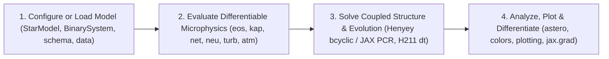

# FlexMESA: Modular, Memory-Safe, and Differentiable Stellar Astrophysics

**FlexMESA** is a modular, memory-safe, and end-to-end differentiable library for stellar structure, interacting binary evolution, and asteroseismology. It reimplements the physical equations, numerical solvers, and microphysical data tables of the [Modules for Experiments in Stellar Astrophysics (MESA)](https://docs.mesastar.org) codebase on an integrated three-tier hybrid architecture combining **Safe Rust (`#![forbid(unsafe_code)]`)**, zero-copy **Python (`PyO3` / `flexmesa._rust`)**, and **JAX (`float64` `@jax.jit` + `jax.vmap`)**.

Stellar evolution connects microphysical processes in dense plasma interiors (equations of state, radiative and conductive opacities, screened thermonuclear reaction networks, thermal neutrino emission, and turbulent convective mixing) to macroscopic observables across the Hertzsprung-Russell diagram, binary orbital histories, and stellar oscillation spectra. Because traditional procedural stellar evolution codes rely on mutable global state and non-differentiable control loops, calibrating mixing parameters or inferring stellar masses and ages from spectroscopy and asteroseismology typically requires finite-difference grid searches that scale poorly with parameter dimension. `FlexMESA` provides exact analytical Jacobians and reverse-mode automatic differentiation (`jax.grad`) across both individual microphysics kernels and coupled Henyey structure steps because it pairs monomorphized forward-mode dual numbers (`DualOrder1<N>`) and Implicit Function Theorem adjoints (`@jax.custom_vjp`) with IEEE-754 double-precision (`f64` / `jnp.float64`) solvers verified to $\le 10^{-14}$ relative error against upstream Fortran MESA.

---

## Core Scientific Workflows

### 1. Single & Binary Stellar Evolution
Initialize Zero-Age Main Sequence (`ZAMS`) stars, convective pre-main-sequence (`pre-MS`) polytropes, or upstream MESA `.mod` models in [`flexmesa.star`](concepts/stellar-structure-and-hydro.md), and evolve coupled 1D hydrostatic or hydrodynamic interiors with adaptive remeshing, convective overshooting, Burgers multi-fluid element diffusion, shellular rotation, and Spruit-Tayler magnetic dynamos. Couple evolved donor and accretor stars or compact companions in [`flexmesa.binary`](concepts/binaries.md) to model Eggleton Roche-lobe geometry, implicit Ritter and Kolb-Ritter mass transfer, Kerr black-hole spin evolution, gravitational-wave radiation, magnetic braking, and Hut tidal circularization.

- **Getting Started**: [5-Minute Quickstart](getting-started/quickstart.md) | [Coming from Fortran MESA](getting-started/coming-from-mesa.md)
- **Tutorials & Guides**: [Single-Star Evolution](tutorials/01-single-star-evolution.md) | [Massive Stars & Hydro](tutorials/02-massive-stars-and-hydro.md) | [White Dwarfs & Diffusion](tutorials/03-white-dwarfs-and-diffusion.md) | [Interacting Binaries](tutorials/04-interacting-binaries.md) | [Inlists & Models](guides/inlists-and-models.md) | [Custom Physics Hooks](guides/custom-physics-hooks.md)
- **Domain Physics**: [Stellar Structure & Hydrodynamics](concepts/stellar-structure-and-hydro.md) | [Convection, Mixing & Rotation](concepts/convection-mixing-rotation.md) | [Interacting Binaries](concepts/binaries.md)

### 2. Differentiable Microphysics & Inverse Problems
Evaluate the 7-component equation of state ([`flexmesa.eos`](concepts/eos.md)), radiative and conductive Rosseland mean opacities ([`flexmesa.kap`](concepts/opacity-and-atmospheres.md)), 5-channel thermal neutrino losses ([`flexmesa.neu`](concepts/nuclear-and-neutrinos.md)), Mixing-Length Theory and Time-Dependent Convection ([`flexmesa.turb`](concepts/convection-mixing-rotation.md)), and stiff thermonuclear reaction networks ([`flexmesa.net`](concepts/nuclear-and-neutrinos.md)) on multi-core CPU (`backend="rust"`) or GPU (`backend="jax"`). Propagate exact derivatives with `jax.grad`, `jax.jacfwd`, and `jax.vmap` for Hamiltonian Monte Carlo, variational inference, and sensitivity analysis without finite-difference truncation error.

- **Tutorials & Guides**: [Differentiable JAX Workflows](tutorials/06-differentiable-jax-workflows.md) | [Backends & CPU/GPU Performance](guides/backends-and-performance.md)
- **Background & Numerics**: [Hybrid Architecture & Autodiff](concepts/architecture.md) | [Equations of State](concepts/eos.md) | [Nuclear Networks & Neutrinos](concepts/nuclear-and-neutrinos.md)

### 3. Asteroseismology & Pulsation Modeling
Compute cumulative acoustic transit integrals, asymptotic and solar-scaled global oscillation parameters ($\Delta\nu$, $\nu_{\max}$, $\nu_{\mathrm{ac}}$, and dipole gravity-mode period spacing $\Delta\Pi_1$), base-of-convection-zone and $\mathrm{He\,II}$ acoustic glitch depths, five empirical surface-effect frequency correction laws (`kjeldsen`, `cubic`, `combined`, `power_law`, `sonoi`), and Roxburgh & Vorontsov (2003) 5-point frequency separation ratios ($r_{01}, r_{10}, r_{02}$) in [`flexmesa.astero`](concepts/asteroseismology.md). Export interior profiles directly to `GYRE`, `FGONG`, and `OSC` formats and generate publication-styled diagnostic figures with `flexmesa.plotting`.

- **Tutorials & Guides**: [Asteroseismology & Pulsations](tutorials/05-asteroseismology-and-pulsations.md) | [Diagnostic Plotting](guides/diagnostic-plotting.md)
- **Domain Physics**: [Asteroseismology & Pulsation](concepts/asteroseismology.md) | [Opacity, Atmospheres & Synthetic Photometry](concepts/opacity-and-atmospheres.md)

---

## Conceptual Overview: How FlexMESA Works



1. **Configure or Load Model**: Initialize a 1D Lagrangian stellar model (`StarModel.from_zams`, `from_pre_ms`, or `from_mod_file`) or validate Fortran namelists (`&star_job`, `&controls`, `&binary_controls`) against typed schemas (`flexmesa.schema`) backed by SHA-256 verified, zero-copy `.safetensors` physics tables (`flexmesa.data`).
2. **Evaluate Differentiable Microphysics**: Compute thermodynamic states (`eos`), Rosseland opacities (`kap`), screened reaction rates and networks (`rates`, `net`), thermal neutrino losses (`neu`), and convective transport (`turb`) across all radial shells. When `backend="auto"` (the default), NumPy arrays route zero-copy to parallel Safe Rust (`rayon`) while `jax.Array` inputs compile into branchless `@jax.jit` GPU kernels.
3. **Solve Coupled Structure & Evolution**: Assemble the coupled 1D Lagrangian hydrostatic or hydrodynamic residuals and block-tridiagonal Henyey Jacobian, and solve the Newton-Raphson correction step using Hirshman et al. (2010) parallel odd-even cyclic reduction (`bcyclic`) on CPU or $\lceil \log_2 N_{\mathrm{zones}} \rceil$ vectorized Parallel Cyclic Reduction (`solver_mode="pcr"`) and Implicit Function Theorem adjoints (`solver_mode="rust_ffi"`) in JAX.
4. **Analyze, Plot & Differentiate**: Extract evolutionary tracks (`HistoryRow`), synthetic Kurucz filter magnitudes (`flexmesa.colors`), pulsation structure files (`to_gyre_str`, `to_fgong_str`), asteroseismic surface corrections (`flexmesa.astero`), and publication-quality diagnostic plots (`flexmesa.plotting`), or differentiate scalar observables with respect to model parameters via `jax.grad`.

---

## 12-Line Python Quickstart

The self-contained example below loads a $1\,M_\odot$, $Z = 0.02$ Zero-Age Main Sequence star, advances its coupled structure and nuclear burning across 10 evolutionary steps using the parallel `bcyclic` Henyey solver, inspects its central thermodynamic state, and differentiates the photospheric radiative gradient with respect to temperature via `jax.grad`:

```python
import jax
import jax.numpy as jnp
from flexmesa import star, turb

model = star.StarModel.from_zams(initial_mass=1.0, initial_z=0.02)
model.evolve(max_steps=10, use_bcyclic=True)
row = model.history_row()
print(
    f"Age={row.star_age:.2e} yr, log10(L/Lsun)={row.log_l:.4f}, "
    f"log10(Tc)={row.log_center_t:.4f}, X_c={row.center_h1:.6f}"
)
grad_t_sens = jax.grad(
    lambda gradr: turb.set_mlt_jax(
        1.0, 1.0, 2.0e8, 2.7e4, 1.5e9, 1.0e-5, 1.0e8, 1.0e5, 1.0, gradr, 0.40, 0.40
    )[1]
)(jnp.float64(0.45))
print(f"Convective d(grad_T)/d(grad_r) = {float(grad_t_sens):.6f}")
```


*Figure 1: The left panel displays the radiative ($\nabla_{\mathrm{rad}}$, blue solid curve), adiabatic ($\nabla_{\mathrm{ad}}$, orange dashed curve), and actual Mixing-Length Theory ($\nabla_T$, green dash-dotted curve) logarithmic temperature gradients across enclosed mass $m/M_\star$ for a $4\,M_\odot$, $Z = 0.02$ Zero-Age Main Sequence model ($N_{\mathrm{zones}} = 1094$), highlighting the convective core boundary where $\nabla_{\mathrm{rad}} = \nabla_{\mathrm{ad}}$. The right panel shows the Zero-Age Main Sequence locus across the built-in 8-mass anchor catalog ($M_\star \in [0.51, 15.0]\,M_\odot$ at $Z = 0.02$) in the Hertzsprung-Russell diagram alongside a $4\,M_\odot$ core hydrogen-burning evolutionary trajectory.*

---

## Subpackages by Scientific Domain

| Domain | Subpackage | Rust Crate | Primary Capabilities |
| :--- | :--- | :--- | :--- |
| **Stellar & Binary Evolution** | `flexmesa.star` | `flexmesa-star`, `flexmesa-star-data` | 1D Lagrangian hydrostatic/hydrodynamic structure, `ZAMS`/`pre-MS`/`.mod` initialization, coupled Henyey solver, overshooting, winds, diffusion, rotation, HLLC Riemann hydro, `RSP2` pulsation, and `GYRE`/`FGONG`/`OSC` exports |
| | `flexmesa.binary` | `flexmesa-binary` | Coupled `Donor + PointMass` and `Donor + Accretor` orbital evolution, Eggleton Roche-lobe geometry, implicit Ritter and Kolb-Ritter RLOF mass transfer, Kerr BH ISCO spin, $\dot{J}_{\mathrm{gr}}$, $\dot{J}_{\mathrm{mb}}$, and Hut tides |
| **Asteroseismology & Observables** | `flexmesa.astero` | `flexmesa-astero` | Acoustic transit integrals, $\Delta\nu$, $\nu_{\max}$, $\nu_{\mathrm{ac}}$, $\Delta\Pi_1$, acoustic glitch depths, 5 surface-effect corrections (`kjeldsen`, `cubic`, `combined`, `power_law`, `sonoi`), separation ratios ($r_{01}, r_{10}, r_{02}$), and $\chi^2$ optimizers |
| | `flexmesa.colors` | `flexmesa-colors` | Kurucz (2003) 3D cubic Hermite SED synthesis, bolometric corrections, and synthetic Johnson `UBVRIJM` filter photometry in Vega, AB, and ST systems |
| | `flexmesa.plotting` | Pure Python / `matplotlib` | Publication-styled `matplotlib` replacements for `PGSTAR`: HR, $\log T_c$ vs. $\log\rho_c$, Kippenhahn, propagation, echelle, separation-ratio, and binary evolution figures |
| **Equations of State, Opacity & Atmospheres** | `flexmesa.eos` | `flexmesa-eos` | Unified 7-component EOS (`Ideal`, `HELM`, `PC`, `Skye`, `FreeEOS`, `OPAL/SCVH`, `CMS`), $C^2$ polygonal quintic blending, $(\rho, T)$, $(P_{\mathrm{gas}}, T)$, and $(\gamma, e)$ root-finding inversions, and 26-slot thermodynamic state |
| | `flexmesa.kap` | `flexmesa-kap` | Fixed-metal (Type 1), C/O-enhanced (Type 2), and low-$T$ molecular radiative opacities, Poutanen (2017) Compton scattering, and Potekhin/Blouin degenerate electron conduction |
| | `flexmesa.atm` | `flexmesa-atm` | Grey $T(\tau)$ relations (Eddington, solar Hopf, Krishna-Swamy, Trampedach, Ball), Guillot (2010) irradiated atmospheres, and 7 tabulated photosphere/white-dwarf boundary tables |
| | `flexmesa.ionization` | `flexmesa-ionization` | 2D bicubic $\mathrm{Fe}^{56}$ charge in $\mathrm{He}^4$, 4D $(X, Z, \log_{10} Q, \log_{10} T)$ partial ionization tables, and Paquette/Dupuis continuum depression |
| **Nuclear Physics, Neutrinos & Convection** | `flexmesa.chem` | `flexmesa-chem` | 347 built-in reference nuclides (plus full `isotopes.data` parser), 286 solar isotopes, 10 solar abundance scales (`AG89` through `AAG21`), composition moments ($\bar{A}, \bar{Z}, Y_e$), and reaction $Q$-values |
| | `flexmesa.rates` | `flexmesa-rates` | 316 built-in REACLIB thermonuclear rates, detailed-balance reverse rates, Salpeter/Chugunov/extended plasma screening, and weak/electron-capture tables (`LMP`, `Oda`, `FFN`, `Suzuki`) |
| | `flexmesa.net` | `flexmesa-net` | Arbitrary nuclear reaction networks (`basic.net`, `approx21.net`, `cno_extras.net`), SIMD dual-number analytical Jacobians, `@jax.custom_vjp` bindings, and stiff `RODAS4`/Bader-Deuflhard 1-zone burners |
| | `flexmesa.neu` | `flexmesa-neu` | Itoh et al. (1996) 5-channel thermal neutrino losses (`pair`, `plas`, `phot`, `brem`, `reco`) with exact $(T, \rho, \bar{A}, \bar{Z})$ Jacobians |
| | `flexmesa.turb` | `flexmesa-turb` | Local Mixing-Length Theory (`Cox`, `Henyey`, `ML1`, `ML2`, `Mihalas`), Kuhfuss (1986) Time-Dependent Convection (`TDC`) with Implicit Function Theorem sensitivities, semiconvection, and thermohaline mixing |
| **Linear Solvers, Splines & Autodiff** | `flexmesa.mtx` | `flexmesa-mtx` | Dense, banded, CSR sparse, sequential block-Thomas, parallel Hirshman `bcyclic`, and GPU $\lceil \log_2 N_{\mathrm{zones}} \rceil$ Parallel Cyclic Reduction (`pcr`) and `@jax.custom_vjp` (`rust_ffi`) block-tridiagonal solvers |
| | `flexmesa.num` | `flexmesa-num` | Bracketed/unbracketed scalar root-finders, Brent/Nelder-Mead optimizers, adaptive Simpson quadrature, explicit Runge-Kutta, and stiff L-stable Rosenbrock and damped Newton solvers |
| | `flexmesa.interp_1d`, `flexmesa.interp_2d` | `flexmesa-interp1d`, `flexmesa-interp2d` | 1D Steffen (1990) monotonic (`interp_pm`) and quartic-slope (`m3a`, `m3b`, `m3q`) piecewise cubics, conservative cell-average remapping, and 2D bicubic Hermite and Akima splines |
| | `flexmesa.auto_diff` | `flexmesa-autodiff` | Const-generic first-order (`DualOrder1<N>`) and multi-variable second/third-order hyperdual numbers (`AutoDiffReal2VarOrder2`, `AutoDiffReal2VarOrder3`) registered as JAX PyTrees |
| **Configuration, Data & Verification** | `flexmesa.constants`, `flexmesa.math`, `flexmesa.utils` | `flexmesa-const`, `flexmesa-math`, `flexmesa-utils` | Bit-exact CODATA/IAU CGS physical constants, 33 domain-safe IEEE-754 elementary intrinsics, string tokenizers, and persistent `rayon` worker pools |
| | `flexmesa.schema`, `flexmesa.data`, `flexmesa.testing` | `flexmesa-schema`, `flexmesa-data`, `flexmesa-testing` | Typed `.defaults` and Fortran `inlist` namelist parsers/validators, SHA-256 verified zero-copy `.safetensors` table loaders, and upstream `<pkg>/test/test_output` golden baseline comparators |

---

## Citing FlexMESA and MESA

`FlexMESA` is distributed under the **GNU Lesser General Public License v3.0 or later (`LGPL-3.0-or-later`)**. Its physical formulations, numerical algorithms, reference test cases, and converted microphysical data tables derive from the upstream [MESA (Modules for Experiments in Stellar Astrophysics)](https://github.com/MESAHub/mesa) project. Any scientific publication using `FlexMESA` should cite both the `FlexMESA` software repository and the six MESA instrument papers:

1. **MESA I**: Paxton, B., Bildsten, L., Dotter, A., Herwig, F., Lesaffre, P., & Timmes, F. (2011), *"Modules for Experiments in Stellar Astrophysics (MESA)"*, ApJS, 192, 3, [doi:10.1088/0067-0049/192/1/3](https://doi.org/10.1088/0067-0049/192/1/3).
2. **MESA II**: Paxton, B., Cantiello, M., Arras, P., et al. (2013), *"Modules for Experiments in Stellar Astrophysics (MESA): Planets, Oscillations, Rotation, and Massive Stars"*, ApJS, 208, 4, [doi:10.1088/0067-0049/208/1/4](https://doi.org/10.1088/0067-0049/208/1/4).
3. **MESA III**: Paxton, B., Marchant, P., Schwab, J., et al. (2015), *"Modules for Experiments in Stellar Astrophysics (MESA): Binaries, Pulsations, and Explosions"*, ApJS, 220, 15, [doi:10.1088/0067-0049/220/1/15](https://doi.org/10.1088/0067-0049/220/1/15).
4. **MESA IV**: Paxton, B., Schwab, J., Bauer, E. B., et al. (2018), *"Modules for Experiments in Stellar Astrophysics (MESA): Convective Boundaries, Element Diffusion, and Massive Star Explosions"*, ApJS, 234, 34, [doi:10.3847/1538-4365/aaa5a8](https://doi.org/10.3847/1538-4365/aaa5a8).
5. **MESA V**: Paxton, B., Smolec, R., Schwab, J., et al. (2019), *"Modules for Experiments in Stellar Astrophysics (MESA): Pulsating Variable Stars, Rotation, Convective Boundaries, and Energy Conservation"*, ApJS, 243, 10, [doi:10.3847/1538-4365/ab2241](https://doi.org/10.3847/1538-4365/ab2241).
6. **MESA VI**: Jermyn, A. S., Bauer, E. B., Schwab, J., et al. (2023), *"Modules for Experiments in Stellar Astrophysics (MESA): Time-dependent Convection, Energy Conservation, Automatic Differentiation, and Infrastructure"*, ApJS, 265, 15, [doi:10.3847/1538-4365/acae8d](https://doi.org/10.3847/1538-4365/acae8d).
